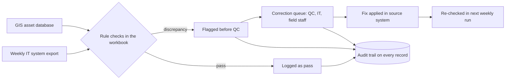

# Replacing a Four-Hour Weekly Asset-Records Audit with a Rule-Based Excel Workbook

*Data Management Technician (contract) · a Sacramento-area wastewater district · May 2025 – January 2026 · Txais Xiong*

## Abstract

A wastewater district keeps its sewer assets (pipes, manholes, lift stations) in two systems: a GIS asset database that maps every asset, and a separate asset-management system that handles work orders and maintenance. When the two disagree, crews can be sent to the wrong asset and reports can go out wrong. During my contract as Data Management Technician, I owned the weekly reconciliation of the two. The audit was done by hand, took about four hours per cycle, and depended on who performed it. I observed that the comparison had a fixed core (the same source systems, the same fields, the same definition of a match) and rewrote it as written pass/fail rules inside an automated Excel workbook. The workbook ingests the weekly export, runs every rule, flags discrepancies before quality control (QC) review, and keeps an audit trail on each record. I also owned the correction queue, routing flagged records to QC, IT and field staff. By my account, the audit cycle fell from four hours to under 15 minutes, a cut of about 95% and roughly 180 staff hours a year. This paper describes the problem, the design, the process, and the evidence for those figures. It also states plainly what the record does not show: the original rule list is not reproduced, and the savings figures are self-reported rather than independently measured.

## 1 Introduction / problem

Infrastructure organizations depend on records that agree with each other. A district that maintains thousands of miles of sewer pipe typically holds at least two views of every asset. One is spatial: where the asset is, its shape and its attributes, stored in a **GIS** (geographic information system, a database that ties records to map locations). The other is operational: the work orders, service requests and maintenance history for the asset, held in an **asset-management system** (also called a CMMS, computerized maintenance management system; this district used Maximo). If the same manhole has one identifier in one system and a different attribute in the other, the consequences are practical. A crew is dispatched to the wrong place, a report undercounts or overstates an asset class, or an engineering change never reaches the map.

At this district, the two systems were checked against each other every week by a person. By my account, that took about four hours per cycle. The task had two weaknesses. It was slow, and it was subjective: whether a pair of records "looked right" depended on the reviewer's attention and habits, so the same inputs could produce different answers on different days.

This paper documents how I replaced that manual comparison with a rule-based workbook. The questions it addresses are:

1. Can a recurring cross-system record audit be expressed as explicit rules without losing the checks that mattered?
2. What does the automation change in cycle time and in how discrepancies are handled afterward?
3. What can and cannot be claimed from the evidence that remains?

I keep the claims narrow. The work was a single-site, single-role effort, and the evidence is my own role record. Section 8 spells out what that means for how far the results generalize.

## 2 Background and context

**The setting.** The district is a public utility that collects and treats wastewater. Its field operations, IT group, QC reviewers and data staff all touch asset records, so a correction usually crosses team boundaries. My role was a contract Data Management Technician position from May 2025 to January 2026, hybrid on-site and remote.

**The two systems.**

| System | What it holds | Role in the audit |
|---|---|---|
| GIS asset database (an ArcGIS / ESRI database) | Mapped assets, geometry, descriptive attributes | Treated as one side of the comparison |
| Asset-management system (Maximo) | Work orders, service requests, maintenance records | Source of the weekly export compared against GIS |

**Related duties.** Separately from the weekly audit, my role included service-request change control in Maximo. I took service requests through to closure, updating asset geometry, descriptive fields and property lines so that the records matched the engineering drawings. Where I needed to confirm a pipeline length or a cleanout location, I cross-referenced inspection video (viewed in a tool called Granite) against the asset records. These duties matter to the paper for one reason: they put me in daily contact with the same record types the audit compared, which shaped what I knew a "match" had to mean.

**Why a rule-based approach.** My general working pattern, which I set out in my professional notes, is to look for the deterministic core of a manual process before reaching for anything more sophisticated. A process whose inputs, fields and expected behavior are fixed can be written down as rules. Rules have a property that matters in public-sector settings: the next person can read them, check them and change them, and a contract role by definition ends. A model whose behavior cannot be inspected is harder to hand over.

## 3 Data and sources

I did not run an experiment with a dataset, so this section describes the inputs the workbook handled and the sources the paper relies on, not a research corpus.

**Inputs to the weekly cycle.**

- A weekly export from the district's IT systems. Per my role description, this was the asset-management side of the comparison.
- The GIS asset database, treated as the reference for what exists on the map.
- Engineering drawings, used as the arbiter when records disagreed about what was physically built.

**Records I do not reproduce.** The inputs are employer records. This paper contains no real asset identifiers, locations or work-order data. Every example below is made up and labeled as such.

**Sources for this paper.** The factual claims rest on four things:

1. My résumé and career-profile copy (September 2026 versions), which record the role, dates, the 4-hour and under-15-minute figures, the 95% figure and the 180-hour figure.
2. Project notes I keep that describe the work and the correction-queue outcome.
3. A business-case worksheet in my notes that derives the annual figure (see Section 6).
4. My earlier short case-study page on the same project, with which this paper is consistent.

All of these are my own records. None is an independent audit, and I treat the numbers accordingly.

## 4 Method / system design

### 4.1 Design principles

1. **Write the comparison down.** Each check becomes a written rule with a fixed pass/fail outcome. "Does this look right?" becomes a yes-or-no test.
2. **Run every rule on every record, every cycle.** Coverage should not depend on the reviewer's energy that day.
3. **Flag before QC, not after.** Discrepancies are surfaced ahead of QC review, so reviewers spend their time on resolution rather than detection.
4. **Leave a trail.** Each record carries what was checked, what failed and what was done about it.
5. **Keep a human owner on every exception.** The workbook detects; people correct.

### 4.2 Weekly data flow

### 4.3 Kinds of check (illustrative)

The district's actual rule list is not documented in the records I kept, and I do not reproduce it. The table shows the three **kinds** of check the workbook performed, each with a made-up example. The identifiers and values are invented for illustration and correspond to no real asset.

| Kind of check | Made-up example |
|---|---|
| Asset exists in one system but not the other | Manhole `MH-0001` appears in the GIS database but is absent from the export |
| Same asset, different attribute | Pipe `P-0002` is recorded as 100 ft in GIS and 94 ft in the export |
| Record does not match the engineering drawing | A cleanout shown on a drawing has no record in either system |

The first two are comparisons between systems. The third compares a record with an external reference, which is why engineering-drawing matching appears both in the audit and in my change-control work.

### 4.4 The correction loop

A flagged record is not finished when it is flagged. In my role, I owned the correction queue end to end. A discrepancy went to the team that could resolve it: QC for review questions, IT for export or system issues, field staff for physical verification. After the fix, the next weekly run re-tested the record. A record that still failed stayed in the queue.

By my account, this changed how long corrections took: they moved from roughly quarterly to resolution in days. I treat that as self-reported, because I do not have a timestamped log to cite (Section 8).

## 5 Implementation and process (how it was built and tested)

**What the sources document.** The solution was an automated Excel workbook. It took the weekly export, applied the rules, produced a list of flagged records and recorded an audit trail. I owned the reconciliation and the correction queue, and I designed the rules.

**How I build.** My general method, which I describe here as my own account, is to design the logic and the test cases myself, have an AI assistant write the code or formulas, and then test and iterate until the output is right. I do not hand-write code. The records I kept do not say which parts of this particular workbook were produced in this way, so I make no project-specific claim about it.

**Testing.** What follows is a general outline of how I test rule-based logic, not a record of what was done on this project. The records I have do not include the original test files, and I do not claim these exact steps were followed.

1. For each rule, build a small set of records that should pass and records that should fail.
2. Run the workbook and confirm each record lands on the expected side.
3. Compare the workbook's flag list against what a manual pass would have found on a recent cycle.
4. Adjust rules where the workbook flagged something a reviewer would accept, or missed something a reviewer would catch, and repeat.

Step 3 deserves a caveat. I cannot report a measured agreement rate between the workbook and the old manual process, because no such figure was recorded.

**Rollout.** The workbook replaced the manual pass as the weekly audit. The recurring cycle then provided continuous feedback: each week's results either confirmed earlier fixes or surfaced new discrepancies.

## 6 Results

### 6.1 Cycle time

| Measure | Before | After | Change | Basis |
|---|---|---|---|---|
| Time per weekly audit | about 4 hours | under 15 minutes | about 95% | Self-reported, résumé and project notes |
| Staff time recovered per year | n/a | roughly 180 hours | n/a | Self-reported; derived (see below) |
| Correction turnaround | roughly quarterly | days | n/a | Self-reported, project notes |
| Audit trail | not stated for the manual process | on every record | n/a | Design property of the workbook |

### 6.2 Checking the arithmetic

Because these are headline numbers, I checked that they are consistent with one another.

| Quantity | Value | Note |
|---|---|---|
| Time saved per cycle | about 3.75 hours | 4 hours minus 15 minutes |
| Cycles per year implied by 180 hours | about 48 | 180 / 3.75 = 48 |
| Reduction if the new time is exactly 15 minutes | 93.75% | (240 - 15) / 240 |
| New time implied by a 95% reduction | about 12 minutes | 240 x 0.05 |

Two things follow. First, "under 15 minutes" and "about 95%" are consistent only if the typical run was closer to 12 minutes than to 15, which fits "under 15." Second, the 180-hour figure assumes about 48 cycles a year rather than 52, which allows for holidays and leave. My notes derive the annual figure this way; I did not find a count of the actual number of cycles run, so the 180 hours is an estimate of recovered capacity, not a payroll measurement.

### 6.3 Qualitative outcomes

- **Consistency.** The same inputs produce the same answer regardless of who runs the workbook. This follows directly from fixed rules and does not depend on a measurement.
- **Traceability.** Every discrepancy had an owner and a record until it was fixed.
- **Shifted effort.** Time that went into finding discrepancies went to resolving them, with field coordination as the main beneficiary of the recovered hours.

## 7 Discussion

**What worked.** Three decisions did most of the work.

1. *Treating the audit as a rules problem.* The audit did not need judgment. It needed the same comparison, run the same way, every week. That is the property that makes automation reliable, and it is why the savings were large.
2. *Placing detection before QC.* Moving the flag ahead of review changed the QC reviewer's job from searching to resolving.
3. *Owning the correction queue.* Detection alone would have produced a longer list of known problems. Closing the loop with QC, IT and field staff is what turned the list into fixed records. This is also where the shift from roughly quarterly to days came from, by my account.

**Why a spreadsheet.** The records name Excel as the platform but do not record why I chose it. A spreadsheet needs no new software to deploy, and its output can be opened by non-technical reviewers. The tradeoff is that logic embedded in formulas is harder to maintain than logic held in a separate rules file; I return to this under Future work.

**Deterministic before intelligent.** I chose fixed rules over a statistical approach because every check had a clear right answer and because rules can be audited. Rules also give a clear explanation of any flag: the record failed this specific test. The cost is rigidity. A rule catches what it was written to catch, and nothing else.

**Tradeoffs.**

| Choice | Benefit | Cost |
|---|---|---|
| Fixed pass/fail rules | Repeatable, explainable, handover-friendly | Misses discrepancy types nobody wrote a rule for |
| Weekly cadence | Predictable rhythm | Errors can sit for up to a week before detection |
| Logic inside the workbook | No new software to deploy | Changes require editing formulas |
| Audit trail on every record | Accountability and traceability | Extra bookkeeping per cycle |

## 8 Limitations and threats to validity

I list these in order of how much they affect the paper's claims.

1. **The figures are self-reported.** The 4-hour, 15-minute, 95% and 180-hour numbers come from my résumé, notes and recollection of the work. I have no independent timing log, supervisor attestation or system record that I can cite in this paper.
2. **The "before" baseline is approximate.** "About four hours" was my estimate of the manual cycle. Manual review is variable, and a different reviewer could have been faster or slower.
3. **The original rule list is not reproduced.** The rules belong to the district and were not preserved in a form I can publish. The three check kinds in Section 4.3 are illustrative, with invented data, and not a complete or exact list. A reader cannot reproduce my workbook from this paper.
4. **No measured accuracy.** I did not record how many true discrepancies the workbook caught compared with the manual process, nor its false-flag rate. The paper therefore supports a claim about time and consistency, not about detection accuracy.
5. **The annual figure rests on an assumption.** The 180 hours assumes about 48 cycles a year at 3.75 hours saved each; the actual cycle count is not documented.
6. **The correction-turnaround improvement is anecdotal.** "Quarterly to days" reflects my account of the queue, not a dated log.
7. **Attribution is not isolated.** Other changes at the district during the same months could have contributed to faster corrections. I cannot separate them.
8. **Single site, single person.** One district, one analyst, eight months. The result may not transfer to a district with messier source data or a less stable export format.
9. **No follow-up.** My contract ended in January 2026. I do not know whether the workbook is still in use, how it has been maintained, or how it performed after I left.

## 9 Future work

These are the changes I would make, in the order I would make them.

1. **Move the rules out of the workbook into a separate rules file.** Staff could then add or edit a check without touching formulas. I have used a configurable rules file on another project, and it removed the analyst-waits-on-engineer dependency there.
2. **Validate at the point of entry.** Catching a bad record when it is created is cheaper than catching it a week later. This would shift the audit from detection toward prevention.
3. **Measure from the start.** Log the cycle time, the number of flags per run and the time-to-close for each flag, so that every claim in a future version can be cited from data rather than recollection.
4. **Test against a labeled sample.** Hand-verify a sample of records, then report the workbook's catch rate and false-flag rate.
5. **Report trends.** With a few months of flag counts, the district could see which discrepancy types recur and fix their upstream cause.

## 10 Lessons for practice

1. **Look for the fixed core first.** If the sources, fields and definition of a match are stable, the work is a rules problem. Write the rules before considering anything more elaborate.
2. **Build for the next person.** A contract role ends. Rules that are readable and a trail that explains each flag let someone else maintain the process without me.
3. **Detection is half the job.** The value came from pairing automated flags with an owned correction queue across QC, IT and field staff.
4. **Capture the measurement as you go.** The weakest part of this paper is the evidence, not the method. Timing the old process and the new one for a few cycles would have turned an account into data.
5. **Be exact about what a number means.** I give the savings as "about 95%" and "roughly 180 hours" and show the arithmetic, so a reader can see where the estimate is firm and where it is assumed.

## Sources

- Résumé, September 2026 version (role, dates, cycle-time figures, duties in Maximo change control).
- Career-profile and platform copy, September 2026 (matching role summary and skills).
- Professional-profile notes, business-analyst framing (correction-queue outcome and the derivation of the annual-hours figure).
- Personal notes on my automation approach (the deterministic-first pattern and the handover rationale).
- Short case-study page on the same project, from my portfolio (consistent with this paper).
- Public portfolio: github.com/TxaisX/portfolio
