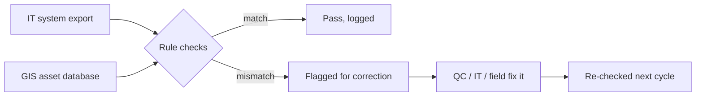

# Cutting a 4-hour weekly reconciliation to 15 minutes

**Sacramento-area wastewater district** · Data Management Technician (contract) · May 2025 – Jan 2026

| | |
|---|---|
| **Result** | Weekly audit from 4 hours to under 15 minutes (about 95%), about 180 staff hours a year |
| **My role** | Owned the reconciliation, designed the rules, built the workbook, ran the correction queue with QC, IT, and field staff |
| **Tools** | Excel (automated workbook), ArcGIS / ESRI asset database, Maximo |

## The problem

The district tracks its sewer infrastructure (pipes, manholes, lift stations) in two places: a GIS asset database that maps every asset, and a separate asset-management system that handles work orders and maintenance. The two have to agree. When they don't, crews get sent to the wrong asset and reports go out wrong.

Every week someone checked them against each other by hand. That took about four hours, and the result depended on who did the checking.

## What I noticed

The audit wasn't a judgment problem. The comparison was the same every week: the same source systems, the same fields, the same idea of what "matching" means. A process with a fixed core like that can be written down as rules, and anything written as rules can run on its own.

## What I built

1. **Wrote the comparison down as rules.** Each check became a written rule with a fixed pass/fail outcome, replacing "does this look right?" with a yes-or-no test.
2. **Built an automated Excel workbook** that takes the weekly export, runs every rule, and produces a list of flagged records.
3. **Kept an audit trail on every record**: what was checked, what failed, and what was done about it.
4. **Owned the correction queue.** Flagged records went to the right team (QC, IT, or field staff), and the next weekly run confirmed each fix.

The rules fell into a few kinds of check, like these (illustrative):

| Check | Example (made-up data) |
|---|---|
| Asset exists in one system but not the other | Manhole `MH-1042` is in GIS, missing from the export |
| Same asset, different attribute | Pipe `P-2210` is 312 ft in GIS and 298 ft in the export |
| Record doesn't match the engineering drawing | A cleanout on the drawing has no record in either system |

## Result

- **4 hours → under 15 minutes** per weekly cycle, about a **95%** cut and roughly **180 staff hours a year** back for field coordination.
- The same inputs now always give the same answer, whoever runs it.
- Every discrepancy had an owner and a paper trail until it was fixed.

## What I'd do next

- Move the rules out of the workbook into a separate rules file so staff can add a check without touching formulas. I'd already done that on the permit program ([case 2](02-permit-classifier.md)).
- Put the checks at the point of entry so bad records are stopped when they're created, not caught a week later.
