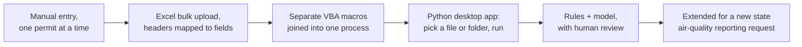
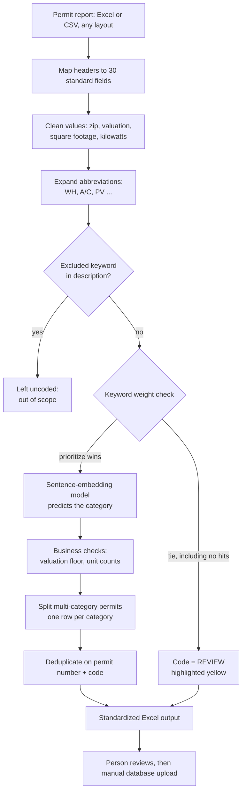

# Writing Down the Judgment Calls: A Rules-First, Model-Assisted Permit Classifier with Human Review

*Data Entry Intern, then Senior Research Analyst · a California statewide construction-research program · November 2023 – May 2025 · Txais Xiong*

## Abstract

A California statewide construction-research program received building-permit reports from 539 jurisdictions, each in its own layout and wording. Analysts read every permit and assigned it one of 33 reporting categories by hand. I started in that manual work as a Data Entry Intern and, over about 18 months, became Senior Research Analyst. This paper describes the permit-classification system I designed there. It has four parts: a JSON configuration file that holds header aliases, 187 excluded keywords, 290 prioritized keywords and a list of 539 jurisdictions; a rule layer that decides whether a permit is codeable; a PyTorch model over sentence embeddings (numeric vectors that capture a sentence's meaning) that assigns the category; and a yellow REVIEW flag that sends uncertain rows to a person before anything reaches the database. I designed the logic and the test cases. ChatGPT wrote the code, and I tested it and iterated. Saved models reached about 85–86% accuracy on a 20% held-out split of 755,294 labelled descriptions. The program's own case study reports coding time per report falling from 64.3 to about 20 minutes (about 69%), analyst throughput up about 93%, and classification error falling from 20–25% to under 10%. Those operational figures are self-reported and were not independently audited. I describe the design, what the archive does and does not document, and what I would change.

## 1 Introduction

The program published research on California construction activity. Its raw material was the permit report that each city and county sent in: a spreadsheet or PDF listing permits issued, with a free-text description of the work. To count rooftop solar, heat-pump installs or new single-family homes, someone had to read each description and assign it a category code.

I did that work myself at the start. Reading permits one at a time taught me three things:

1. In my view, most decisions followed rules that lived in analysts' heads. A permit for a "re-roof" was out of scope. A permit mentioning a photovoltaic system was solar.
2. A smaller set of descriptions was truly ambiguous, and those needed judgment.
3. The work was limited by hours in the day, and we had a backlog.

The question I kept asking was how a team like ours could get more done in less time without lowering accuracy. This paper is my answer: write the rules down, let a model handle the cases the rules cannot, and keep a person on every uncertain case.

**Contribution.** I contribute a working design, not a new algorithm. It consists of an externalized rule configuration that non-programmers could edit, a layered classification pipeline, and a review mechanism built into the output file. I also contribute an honest account of how well the archive supports each claim.

**How I worked.** I do not write code by hand. I worked out the logic step by step, described it to ChatGPT, and had it generate the code. I then ran the code, pasted errors back and iterated until it held. Every design decision in this paper is mine. The implementation was AI-written under my direction.

## 2 Background and context

### 2.1 The reporting problem

Each jurisdiction exports permits in its own format. Column names differ ("Permit #", "Record #", "PERMIT_NO"), and so do the description conventions. The program could not ask a jurisdiction to change its format, because jurisdictions were data suppliers with no obligation to the program. Any solution therefore had to accept files as submitted.

The program's own case study, written during the project, describes the situation before automation. It reports that each report took 7 to 8 hours to enter, that coding took 64 minutes per report, that about 60% of reports arrived as PDFs and about 40% as Excel, and that error rates ran 20–25%. These figures come from the program's internal documentation. I did not re-measure them.

### 2.2 How the tooling grew

I did not design the end state up front. Each step worked, and that made the next one possible.

VBA (Visual Basic for Applications) is the macro language built into Excel. A summary of the early tooling lists 20 VBA macros that extracted details such as unit counts, kilowatt values, square footage, addresses and zip codes. By my account, I outgrew Excel on large datasets and moved the work to Python.

### 2.3 The taxonomy

The program used 33 reporting categories. They fall into four families: new residential buildings (5 categories), new commercial buildings (14), additions, alterations and conversions (5), and energy-related permits (9). The energy family covers solar, heat-pump and air-conditioning changeouts, batteries, electric-vehicle chargers and plumbing such as water heaters. I do not reproduce the category codes here because they belong to the program's internal reporting scheme.

### 2.4 Roles

Over the 18 months I moved from Data Entry Intern to Senior Research Analyst. By my account I reviewed the coding of 5 analysts and trained work-study analysts on the tool. The program was sunset in May 2025.

## 3 Data and sources

### 3.1 Training data

The model's training data came from the program's own history. Analysts' coded reports were consolidated into one table of permit descriptions and the category codes that analysts had assigned.

| Item | Value | Note |
|---|---|---|
| Labelled samples | 755,294 | train 604,235 + test 151,059 per the training log |
| Split | 80% / 20% | stratified by label, fixed random seed |
| Distinct labels in the training run | 34 | one more than the 33 reporting categories; not reconciled in the sources |
| Training set after oversampling | 1,967,893 | random oversampling of rarer classes |
| Consolidated database snapshot | 755,428 rows | a row count I took from a local snapshot of the coded history |

The stated figure of "750,000+" is therefore the 755,294 labelled samples. These are training samples. They are not an audited count of distinct permits processed in production.

### 3.2 Input reports

Production inputs were Excel and CSV reports, one file per jurisdiction, with the city taken from the file name. The program's case study reports that the Excel share of incoming reports rose from about 40% to about 70% after a PDF-to-Excel conversion step added in the third quarter of 2024. About 30% of reports still needed manual intervention, according to the same document. An earlier tool generation also had a PDF reader.

### 3.3 The configuration file

All rule content lives in one JSON file. Its five top-level keys and their sizes are below.

| Key | Contents | Size |
|---|---|---|
| `header_mappings` | standard field names mapped to the alternative column names jurisdictions use | 30 fields |
| `excluded_keywords` | terms that mark work outside the reporting scope | 187 terms |
| `prioritize_keywords` | terms that mark work the program codes | 290 terms |
| `cities_we_take` | the jurisdictions the program accepts | 539 entries |
| `city_code_mapping` | short codes mapped to city names | 12 entries |

A few real values show the flavor:

- **Header aliases:** the standard field `PERMIT NO` accepts "Project Number", "Record #", "Permit #", "Permit Number", "Permit No." and "PERMIT_NO". The field `ISSUE DATE` accepts "PERMIT ISSUE DATE", "date issued" and "issued date".
- **Excluded keywords:** "reroof", "Building signs", "Main panel upgrade", "Generators", "Fire sprinkler system", "Seismic retrofit", "Mobile home", "stop work".
- **Prioritized keywords:** "SFD" (single-family dwelling), "ADUs" (accessory dwelling units), "Solar", "heat pump", "Condenser", "Tesla", "carport", "cell tower".

### 3.4 Documentation I relied on

I used three kinds of source: the program's own case study, a process-overview document I wrote as Senior Analyst, and the archived code, configuration and training artifacts. I treat the code and training logs as evidence of what the system did. I treat the two documents as project-reported claims.

## 4 Method and system design

### 4.1 Design principles

Four principles drove the design.

1. **Accept files as submitted.** The program could not change what jurisdictions send.
2. **Keep rules outside the code.** Anyone on the team should be able to add or remove a keyword without a developer.
3. **Use deterministic rules wherever a rule is enough.** A rule match can be explained to a stakeholder in one sentence. A model output cannot.
4. **Never decide silently.** A row the system cannot classify with confidence becomes a visible exception, not a best guess.

I rejected full automation. A system that removed the person entirely would have written wrong codes into a database where mistakes were harder to reverse.

### 4.2 Pipeline

### 4.3 Stage 1: header mapping and cleaning

The app matches each column header to an alias in `header_mappings` without regard to capitalization and renames it to the standard field. Fields the report lacks are added as blank columns. The city comes from the file name, and each row is marked as a primary-source, issued permit. The cleaning step then extracts the zip code, formats valuation, and pulls square footage and kilowatt capacity out of the free-text description with pattern matching.

### 4.4 Stage 2: rules

The rule layer works in three steps, and it is where my "Boolean" framing needs a precise description. Each keyword list is an OR: a match on any listed term counts. The list is compiled into one case-insensitive pattern that matches singular and plural forms, so I could write a keyword once.

1. **Abbreviation expansion.** Analysts and software abbreviate heavily. A small dictionary expands "WH" and "W/H" to "Water Heater", "A/C" to "Air Conditioner", "PV" to "Photovoltaic" and "HPWH" to "Heat Pump Water Heater" before any matching, so a rule written for the long form also catches the short one.
2. **Exclusion veto.** If any excluded keyword matches the description, the row is left uncoded. A model never overrides an exclusion rule.
3. **Weight check.** The classifier counts occurrences of excluded and prioritized terms in the preprocessed text and compares them. Prioritized terms winning yields CODE. Excluded terms winning yields DO_NOT_CODE. A tie yields REVIEW.

My reading of the code is that step 3's exclusion branch is largely redundant with step 2, because step 2 already removes most rows with an excluded term. The tie case is the main route to REVIEW. A tie includes the case where a description matches neither list, which gives 0 against 0. A description with no recognizable term therefore goes to a person.

### 4.5 Stage 3: the model

Rows marked CODE go to the model. I document two model generations because the archive holds both.

**Generation A: sentence embeddings plus a feedforward network.** The app embeds each description with `all-MiniLM-L6-v2`, a small pretrained sentence-embedding model that turns text into a 384-number vector. A feedforward network (layers of weights applied in sequence) then maps that vector to a category. The network has four layers: 384 inputs, then hidden layers of 1,024, 512 and 256 units, then 33 outputs. It uses dropout (randomly switching off units during training to reduce overfitting) of 0.3. The experiment scripts configure class-weighted cross-entropy loss to compensate for rare categories, the Adam optimizer at a learning rate of 5e-4, and a schedule that halves the rate when the loss plateaus.

**Generation B: a fine-tuned BERT classifier.** BERT is a pretrained language model. I fine-tuned `bert-base-uncased` (the smaller, lowercase-input variant) on the descriptions, with a batch size of 8 and 3 epochs planned. Its saved configuration has 34 output labels. A later loader module in the archive uses this model through a standard HuggingFace interface (a common library for loading pretrained models).

Both generations predict with an argmax: the model returns the single highest-scoring category. In the archived application code, I found no step that compares the winning probability with a cutoff.

### 4.6 Stage 4: review and output

After classification, post-processing applies business rules. Permits with a zero valuation, or one below $2,000, are left uncoded unless the predicted code is on a short list of allowed codes. A permit that mentions two equipment types, such as solar plus a battery, is split into one row per type. When more than one category applies, the model's own category wins if it is among the matches. Otherwise precedence falls to solar, then battery, then HVAC, then plumbing. The pipeline then deduplicates on permit number plus code and writes an Excel file with the REVIEW cells filled yellow and filters switched on.

The yellow fill is the design detail I care about most. The flag lives in the file analysts already open. It is not a separate report that nobody opens. By my account, a reviewer compared the code against the description, correct rows moved on, and wrong rows were recoded and fed back into training. Final validation and the database upload stayed manual.

### 4.7 The confidence gate

By my account, the review step flagged any model result below about 95% confidence as "must review". That figure is my recollection, not a measured value, and I could not locate it in the archived code. Section 8 explains what the archive shows instead.

## 5 Implementation and process

### 5.1 How it was built

My loop was the same at every stage:

1. Work out the next piece of logic as plain steps. For example: if the description contains an excluded term, skip the row.
2. Describe it to ChatGPT and ask for the code.
3. Run the code on real reports. Paste any error back into the conversation.
4. Check the output against what an analyst would have coded. Adjust the logic or the keyword lists.
5. Repeat until the output held.

I supplied the test cases: the reports whose answers I already knew, the awkward descriptions from my own coding days, and the layouts that had broken earlier versions. The AI wrote and rewrote the code, and the judgment about what counted as correct stayed with me.

### 5.2 Training and model selection

The training logs in the archive show how I tested the model.

- **Split and balancing.** I split the data 80/20, stratified by category, with a fixed seed. I then oversampled the rarer categories in the training set only, from 604,235 to 1,967,893 examples. A log line confirms that every original category survived the oversampling. An earlier run used a heavier setting that produced 5,303,932 examples.
- **Feedforward run.** The log records 15 epochs (full passes over the training data) at roughly 56 minutes each, about 14 hours in total.
- **BERT run.** The saved trainer state records evaluation results after each completed epoch. The run was configured for 3 epochs, and the state I have shows 2 completed.
- **Experiments that left no results.** A third script configures an ensemble of the two models with a 0.80 confidence threshold, a similarity-search fallback and a large-language-model call for low-confidence rows, plus a loop for retraining on corrected mistakes. The log for that run ends as fine-tuning begins, and the archive records no result for it. I therefore do not report it as part of the system.

### 5.3 Retraining from reviewer corrections

A separate dashboard script in the archive lists the model's misclassified samples, lets a person correct them, and fine-tunes the model on the corrections. This is the mechanism behind "wrong results were recoded and fed back into training". The archive shows that the tool exists. It does not record how often it was used.

### 5.4 Extending the system for new requirements

In August 2024 the program signed an agreement with a state air-quality agency to report equipment details: HVAC units, water heaters, solar systems and batteries. By my own account, I extended the existing workflow to cover this in about three weeks, without added staff. The archived code supports the claim in structure. It contains equipment extraction, a dictionary of equipment keyword categories (battery, plumbing, solar, HVAC), and row splitting by equipment type. The three-week duration is my recollection and has no document behind it.

### 5.5 A later refactor

The archive also holds a modularized version of the application. It replaces hard-coded settings with swappable jurisdiction profiles and adds a header-mapping module that scores its own confidence. It also adds 32 automated tests across three files: 14 checking that the profile settings match the original application and configuration, 6 running the pipeline end to end, and 12 on header mapping. I did not run them. The end-to-end tests use a stand-in model, so they check the plumbing, not classification accuracy. The sources do not date this refactor, and I do not count it as part of the program-era system.

## 6 Results

### 6.1 Model evaluation

These are measurements from saved training artifacts on the 151,059-sample held-out split.

| Model | Result | Where it comes from |
|---|---|---|
| BERT fine-tune, epoch 1 | accuracy 84.72%, weighted F1 86.06% | saved trainer state |
| BERT fine-tune, epoch 2 (best) | accuracy 85.73%, weighted F1 86.78% | saved trainer state |
| MiniLM plus feedforward, best of 15 epochs (epoch 3) | accuracy 85.08% | training log |
| MiniLM plus feedforward, epoch 15 | accuracy 84.12% | training log |

F1 is a score that balances precision and recall. "Weighted" means each category counts in proportion to how often it occurs. Both generations therefore land in the "about 85–86%" band, and I cite that band for the saved model.

One observation from the feedforward log is worth noting. Test accuracy was already about 83% after epoch 1, peaked at about 85% at epoch 3, and was slightly lower at epochs 12 and 15. More training bought little here, and the ceiling may have come from the labels and descriptions more than from model capacity. That is a hypothesis, not a tested conclusion.

### 6.2 Operational results (project-reported)

These come from the program's own case study and a process overview I wrote as Senior Analyst. They are self-reported and were not independently audited.

| Measure | Before | After | Change |
|---|---|---|---|
| Coding time per report | 64.3 min | about 20 min | about 69% less |
| Analyst throughput (reports per day) | about 7 | about 13.5 | up about 93% |
| Classification error | 20–25% | under 10% (5–10% stated) | project-reported |
| Reports handled at one time | 5 | 15 | stated in my overview |
| Share of reports arriving as Excel | about 40% | about 70% | after the Q3 2024 conversion step |

The case study reports error falling in stages: from 20–25% to 12–15% when AI-assisted classification launched in the first half of 2024, and to 5–10% by the fourth quarter. The percentage changes check out arithmetically: (64.3 − 20) / 64.3 is about 69%, and 13.5 / 7 is about 1.93.

The same documents report that the backlog was significantly reduced by August 2024. By my account the tool cleared the 2024 and 2025 backlogs before the program closed.

I have left out the staffing-reduction and cost-savings figures in the case study. I do not rely on them, and this project does not need them.

### 6.3 Capability results

| Capability | Evidence |
|---|---|
| Statewide configuration | the configuration lists 539 jurisdictions and 30 header fields |
| Multi-category splitting | code splits solar, battery, HVAC and plumbing matches into separate rows |
| Visible review flag | code fills REVIEW cells yellow in the output workbook |
| New reporting requirement absorbed | about three weeks, by my account |
| Staff using the tool | I reviewed the coding of 5 analysts and trained work-study analysts, by my account |

## 7 Discussion

### 7.1 What worked, and why

**Writing the rules down was the main gain.** Most of the work was rule application that had never been made explicit. Moving it into a configuration file turned tacit knowledge into an asset the team could edit. In principle, a new analyst could add a term such as "Tesla" to a list and see the next run change, with no developer involved.

**Putting the veto before the model protected scope.** A model asked about a re-roof permit will still return some category. The exclusion check removed that class of error before the model saw the row.

**The yellow flag fit the way people already worked.** Because the flag lives in the output workbook, reviewers met it on opening the file. Requiring a separate dashboard would likely have meant it was skipped under deadline pressure.

**A simple model was enough.** Embeddings plus four layers matched a much heavier BERT fine-tune to within about a point of accuracy (85.08% against 85.73%). I take that as evidence that the label quality, not the model, set the ceiling. I did not test that explanation, and it remains a hypothesis.

### 7.2 Tradeoffs

| Choice | Benefit | Cost |
|---|---|---|
| Rules gate the model | auditable, predictable, cheap | rules go stale as terminology shifts; short keywords can over-match |
| Argmax prediction, no cutoff in the app | simple code, fast | the model never abstains on its own |
| Tie goes to REVIEW | nothing is decided silently | uncodeable descriptions also land in the queue |
| Review is manual, in Excel | no new tooling for analysts | no audit trail of who changed what |
| Config edited by hand | any analyst can maintain it | a bad edit changes behavior on the next run |

### 7.3 Where the design is stronger than the evidence

The strongest part of the system is its structure. The strongest evidence I hold for outcomes is the program's own case study. The two do not fully line up, and Section 8 spells out why.

## 8 Limitations and threats to validity

**Operational figures are self-reported.** Time per report, throughput and the error reduction come from the program's own documents. The original measurement files are not in the archive, so I cannot recompute them. I treat them as project-reported results, not benchmarks.

**Model accuracy and operational error measure different things.** The saved models reach about 85–86% accuracy, which implies roughly 14–15% error for the model alone on the held-out split. The reported operational error is "under 10%". I read the lower figure as covering the whole workflow: rules, model and human review. That reading is mine. The sources do not state how the operational error was measured, so I cannot reconcile the two.

**The test split also chose the model.** The held-out split was used to monitor training and to pick the best checkpoint. No data stayed untouched for a final, unbiased estimate. The reported accuracy is therefore slightly optimistic.

**The confidence gate is undocumented.** By my account, results under about 95% confidence were flagged for review. In the archived application, REVIEW comes from the keyword tie described in Section 4.4, and the model predicts by argmax with no probability cutoff. Experimental scripts use a 0.80 threshold, and the refactored profile uses 0.6 for a different purpose. A 95% gate may have existed in a version I do not have. I cannot show it, so I do not report it as a measured property.

**Two model generations, not one.** The application that loads a feedforward model and the loader that uses BERT were not necessarily deployed together. I do not know which model ran in production at any given time. Metrics from different versions should not be merged.

**Label counts do not reconcile.** The business taxonomy has 33 categories. The training runs found 34 distinct labels, and the feedforward model's output layer has 33 units. I did not trace the extra label. It may be a data-cleaning artifact or a code that exists only in the training data.

**Substring matching may over-match short terms.** In the archived application, the weight check counts keywords as substrings of the preprocessed text, whereas the exclusion veto uses word boundaries. A short term such as "ev" could therefore match inside a longer word such as "level". This is my reading of the code, not an observed failure, and I did not measure how often it mattered.

**A production-versus-training distribution gap is possible.** Descriptions in the training data came from past reports. New jurisdictions or new vocabulary could drift away from them. The REVIEW rate would be the early signal, but I have no log of REVIEW rates over time.

**Key-person risk.** One person designed, built and maintained the system. The configuration file and review flag reduce that dependency but do not remove it. I regard this as the weakest part of the delivery.

**No ground-truth comparison with the manual process.** The sources hold no side-by-side test of system codes against analyst codes on the same reports. The "before" error range comes from the program's own estimate.

**Undocumented items.** The following are not recorded in the sources I could examine: the exact rule-layer coverage (the share of permits resolved without review), the REVIEW rate in production, per-category accuracy, how often the retraining tool ran, and the date each model version went into service. The two program documents also differ in scope and detail from the code, so the code remains my primary evidence for behavior.

## 9 Future work

1. **A review queue inside the application.** Today the review is a yellow cell in a spreadsheet. A built-in queue could enforce that every flagged row is resolved before export, and it could record who changed what.
2. **A real confidence gate.** Add a calibrated probability cutoff to the model step and log the REVIEW rate over time, so drift shows up before bad data does.
3. **A clean held-out evaluation.** Keep a test set that never touches model selection, and report per-category accuracy so weak categories are visible.
4. **A measured baseline.** Run the system and a second analyst on the same reports and compare codes directly, so the error figure is measured, not estimated.
5. **Word-boundary matching throughout.** Use the same boundary-aware matching in the weight check as in the veto, and test short keywords against known false matches.
6. **A public demonstration.** Rebuild a small version on open permit data so that anyone can run it. This is planned for my portfolio repository at github.com/TxaisX/portfolio.
7. **A second maintainer.** Write handoff documentation and name a second person who can edit the rules.

## 10 Lessons for practice

1. **Find the rules before reaching for a model.** Much of what looked like judgment was rule application that nobody had written down. Writing it down was the largest single gain.
2. **Put the configuration where the domain experts are.** A JSON file that an analyst can edit meant maintenance did not wait on a developer.
3. **Make uncertainty visible where people already look.** A yellow cell in the working file got reviewed. A separate report might not have been.
4. **Do not let the model overrule a scope rule.** Run exclusion checks before prediction.
5. **Keep a person on the uncertain cases.** The cost of a wrong code in a database outweighed the cost of a short review queue.
6. **Report which numbers you measured.** Training metrics, project-reported outcomes and personal recollection are three different kinds of evidence, and I keep them apart.
7. **Directing AI-written code is a real skill, and so is testing it.** My contribution was defining correct behavior, supplying hard test cases and iterating until the output held. I would document the test set from the start next time.
8. **Write the requirements before the build.** The requirements lived in conversation and in my head. A written document and a named second maintainer would have made the system easier to hand over.

## Sources

- Project configuration file (JSON), holding header mappings, excluded and prioritized keywords, the jurisdiction list and city-code mappings.
- Application source code, including the rule classifier, model wrapper, output formatting and equipment-splitting logic.
- Model training scripts and training logs, dated February 2025.
- Saved model configuration and trainer state for the BERT fine-tune.
- Modularized application source and its automated test files.
- Internal case study of the program's automation results.
- Internal process-overview document written by me as Senior Analyst.
- My own account of the project timeline, the 95% review threshold, the three-week extension and the analyst-review work.
- Public pretrained models: `sentence-transformers/all-MiniLM-L6-v2` and `bert-base-uncased`.
- Short project page in this repository: github.com/TxaisX/portfolio.
