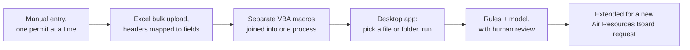
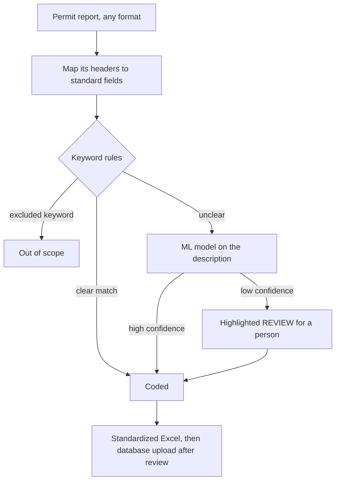

# From manual permit entry to a rules-plus-model classifier

**California statewide construction-research program** · Data Entry Intern → Senior Research Analyst · Nov 2023 – May 2025

| | |
|---|---|
| **Result** | Coding time per report from 64.3 to about 20 minutes (about 69%); analyst throughput up about 93%; classification error from 20–25% to under 10% (project-reported) |
| **My role** | Spotted the problem from inside the manual work, designed the workflow and rules, directed the AI-written code, tested it in production, trained the staff who used it |
| **Tools** | Excel and VBA, Python desktop app (written by AI to my spec), JSON configuration, PyTorch model on sentence embeddings |

## The problem

The program reported on California construction activity. Permit reports arrived from **539 jurisdictions**, each in its own format, and every permit had to be read and coded into one of the program's categories by hand. We had a backlog, and only eight hours in a day.

I started in that manual work myself, so I kept asking: *how could we make this way better, way faster, so a team like ours gets more done in less time?*

## How it grew

I didn't design the end state up front. Each step worked, and that made the next one possible.



## What I built



**1. A configuration file instead of hard-coded logic.** Every report used different column names ("Permit #", "Record #", "PERMIT_NO"…). Instead of fixing each one in code, I put the mappings, keyword lists, and jurisdiction list in one JSON file that non-technical staff could edit. A simplified excerpt, same shape as the real file:

```json
{
  "header_mappings": {
    "PERMIT NO":  ["Permit #", "Permit Number", "Record #", "PERMIT_NO"],
    "SQ FOOTAGE": ["Sq Ft", "SQUARE FEET", "FLOOR AREA (SQ FT)"]
  },
  "excluded_keywords": ["reroof", "sign", "panel upgrade", "repipe"],
  "prioritize_keywords": ["SFD", "ADUs", "Solar", "heat pump"],
  "cities_we_take": ["Alameda", "Berkeley", "Sacramento", "..."]
}
```

**2. Boolean keyword rules first.** Most permits could be decided by rules: if the description contains an excluded term, it's out of scope; if it matches a category's keywords, code it. Rules are fast, predictable, and easy to explain.

**3. A model only for what rules can't decide.** For ambiguous descriptions, a PyTorch model reads the text (as sentence embeddings) and suggests a category. It was trained on **750,000+ labelled permit records** from the program's history.

**4. A person on every uncertain case.** Results the model wasn't confident about were highlighted **REVIEW** in yellow so they couldn't be missed. A reviewer checked the code against the description. Correct results moved on, and wrong ones were recoded and fed back into training. Nothing went into the database without that review.

**5. How the code got written.** I worked out the logic step by step, talked it through with ChatGPT, and had it generate the code. Then I tested the output, pasted the errors back, and iterated until it held.

## Result

Reported in the program's own case study:

| | Before | After |
|---|---|---|
| Coding time per report | 64.3 minutes | about 20 minutes |
| Analyst throughput | baseline | up about 93% |
| Classification error | 20–25% | under 10% |

- When the California Air Resources Board added reporting on equipment (HVAC units, water heaters, solar, batteries), we extended the workflow in **about three weeks**, without adding staff.
- I reviewed the coding of 5 analysts and trained work-study analysts on the tool.
- It cleared the 2024 and 2025 backlogs. I was promoted three times in about 14 months.

The program was sunset in May 2025. I still hold this project close: it's where I learned what kind of work I want to keep doing. That means finding the process that takes too much time, asking how it could be better, and staying with it until it works.

## What I'd do next

- Make the review step enforce itself: a queue in the app instead of a highlight in a spreadsheet.
- Measure accuracy on a held-out set that never touches model selection, so the reported number is airtight.
- Rebuild a small public version on open permit data so anyone can run it. *(Planned for this repo.)*
