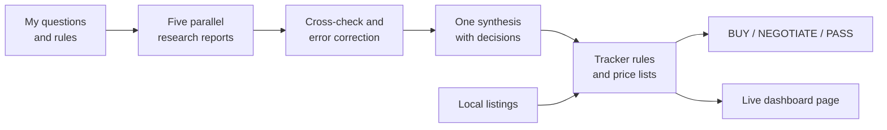

# Buying Used PCs by the Numbers: A Deal Tracker and a Five-Report Market Study

*Independent hobby research · Sacramento, California · September 2026 to present · Txais Xiong*

## Abstract

In September 2026 I started a hobby of buying used gaming PCs and parts locally, testing them, and reselling them. Before spending anything, I treated the project as a research problem with two parts. The first part is a tracker: an Excel workbook holding a parts database of 127 GPU and CPU models, a deal sheet that returns a BUY, NEGOTIATE or PASS verdict for each local listing (184 listings captured), and a local dashboard page that redraws a few seconds after each save. The second part is a market study: five AI research agents, each with a different question (CPUs, GPUs, platform parts, the resale market, and testing), working under one evidence-tagging rule. I set the questions and the tags, cross-checked the reports against each other, and corrected the errors I found before writing one synthesis. The study found a memory and storage price shock, used graphics cards holding or gaining value, a wave of office PCs after Windows 10 support ended, buyers concentrated under $800, and a gap of about $350 between asking and sold prices on a used RTX 3090. I report no profit figures, because the project records I used show no completed sales. The contribution is a repeatable method for researching a used market before buying into it, plus an honest list of what the evidence could not establish.

## 1 Introduction

Reselling used computer hardware looks simple: buy low, test, sell high. In practice a buyer needs to know which parts hold value, which combinations of parts waste money, which sellers' claims are checkable, and what the real selling price is as opposed to the hopeful one. A wrong guess on a single graphics card can erase the margin on several flips.

I wanted to learn that before buying anything. My question had two halves:

1. **Tooling.** Can I build a small system that turns a pile of local listings into consistent buy, negotiate or pass decisions based on rules I wrote down in advance?
2. **Evidence.** What does the 2026 used-PC market actually look like, and how much of what I can read about it is solid enough to base a buying rule on?

I am a data and process analyst, not a hardware engineer, and I do not write code by hand. My working method throughout is the same: I define the questions, the rules and the test cases; AI tools write the code and do the first-pass research; I check the output, find what is wrong, and have it fixed. This paper describes what that process produced, how much I trust it, and where it stops.

## 2 Background and context

**Used-PC flipping** means buying second-hand machines or parts below their resale value, optionally cleaning or repairing them, and selling at a profit. It is a hobby for me. By my account (project note, 28 September 2026), I ranked it as a hobby rather than an income plan, because I judged it "most likely not viable" as income. That framing matters: the project's value to me is the research discipline and the tooling, not a business case.

Four terms recur in this paper.

- **GPU and CPU.** The graphics card and the main processor. In a gaming PC the GPU accounts for roughly 40 to 60 percent of the machine's resale value, according to a price-tracking vendor's guidance that I recorded as a vendor-grade source.
- **Bottleneck.** The part that everything else waits on. The CPU prepares each frame (game logic, physics, draw calls) and that work does not change with screen resolution. The GPU paints the frame and that work grows with the pixel count. At 1080p a weak CPU becomes the limit; at 4K almost any modern CPU keeps up. So "do these parts pair well" always has to be answered at a stated resolution.
- **1% lows.** The frame rate of the slowest 1 percent of frames, which is what stutter feels like. A CPU-limited machine can average 120 frames per second while its 1% lows sit near 45.
- **Evidence tags.** A label on every claim saying how strong its source is (defined in section 4.2).

The 2026 market is unusual. Several things that normally hold in used hardware did not hold this year, which is why I did not trust older rules of thumb and chose to research first.

## 3 Data and sources

### 3.1 The market study

The study consists of five written reports plus one synthesis, all dated 27 September 2026. Together the five reports run to about 20,000 words. They draw on manufacturer pages, benchmark sites, price aggregators, retailer and marketplace fee pages, government and regulator pages, and community discussion summarized by the agents. Prices are US prices for September 2026 and move weekly.

| Report | Question it answered |
|---|---|
| CPU | Performance tiers, core counts, CPU and GPU pairing by resolution, known failure patterns, sockets, used prices |
| GPU | Performance hierarchy, video memory, upscaling and compute features that affect resale, used and new prices, used-card risks, power-supply needs |
| Platform | Motherboards, RAM, storage, power supplies, cooling, compatibility traps, the memory price shock |
| Market | Selling channels and fees, flip models and margins, pricing method, buyer behavior, seasonality, California rules |
| Testing | An at-the-seller inspection, a home bench test with pass criteria, bottleneck diagnosis, refurbishing value, data wiping, a buyer-facing "tested" sheet |

### 3.2 The tracker data

The tracker holds eight sheets (project note, 27 to 28 September 2026):

| Sheet | Contents |
|---|---|
| Dashboard | Settings and live summary figures |
| Deals | One row per listing evaluated, with a BUY, NEGOTIATE or PASS verdict |
| GPUs, CPUs, RAM and Storage | Price lists that the deal sheet looks up by column letter |
| Parts Database | 127 GPU and CPU models with launch price, age, resale price and the share of launch value kept |
| Listings | 184 local marketplace listings captured on 27 September 2026 |
| Drive Times | Drive times to 61 nearby cities, for judging whether a distant listing is worth the trip |

The figures 127 and 184 appear in my resume as well as in the project notes; I confirmed the match. I could not locate the live workbook on disk when preparing this paper, so the sheet names and counts above come from the project note I wrote during the build, not from opening the file. Anything I say about what the workbook computes is therefore a description of its design, not a fresh inspection.

## 4 Method and system design

### 4.1 Overall design

The research feeds the tracker. The synthesis sets the tiers, the pairing logic and the price sanity checks, and the tracker applies them to real listings.

### 4.2 The evidence contract

All five research agents worked under one contract, so that I could weigh claims against each other:

| Tag | Meaning |
|---|---|
| HARD | A named primary source: manufacturer, regulator, benchmark site, measured sales data |
| VENDOR | A commercial blog or a price aggregator, which may have a commercial interest |
| CHARACTERISTIC | Community consensus, paraphrased; useful but not authoritative |
| ESTIMATE | The agent's own inference, with no source |

Every price and rule in the synthesis carries one of these tags. A tag is a statement about the source, not about whether the claim is true, so a HARD claim can still be superseded and an ESTIMATE can still be right.

### 4.3 The tracker components

**Parts database.** A reference table of 127 GPU and CPU models. For each model it stores launch price, age, current resale price and the percentage of launch value kept. Its job is to answer "what is this part worth, and does it hold value?" for any part named in a listing.

**Deal sheet.** Each listing becomes a row. The sheet identifies the parts named in the listing, looks them up in the price lists, compares the listing price against my rules, and returns one of three verdicts: BUY, NEGOTIATE or PASS. The price lists must never be reordered, because the deal sheet finds prices by column letter. I recorded that as a standing rule for the workbook.

**Live dashboard.** A single local page, opened in a browser, that reads the workbook and redraws about three seconds after each Excel save. It loads a small JavaScript library (SheetJS, which reads Excel files in a browser) from the internet once per page load, so it needs a connection.

### 4.4 My buying rules

I set these on 27 September 2026 and they define the PASS boundary:

- **GPU floor:** an RTX 3080 or better among 30-series cards. The RTX 3060, 3060 Ti and 3070 are excluded. Whether the slower RTX 4060, RTX 5060, Arc B580 and RX 7600 stay allowed was still open when I last recorded the rules.
- **CPU floor:** Intel 12th generation or Ryzen 5000 series, or newer.
- **No single parts at market price.** The strategy is underpriced whole PCs that I can test and then sell whole or in parts.
- **Do not hold RAM hoping the price rises.** Sell it within weeks.
- **Be careful with Intel 13th and 14th generation chips.** Buy cheap or skip, because of a known degradation problem (section 6.4).

The synthesis also lists default decisions for me to confirm: price RAM and SSDs as separate line items, advertise 8 GB graphics cards as 1080p cards only, replace unknown power supplies in any build with a GPU drawing over 200 watts, and accept office PCs only if they can run Windows 11.

## 5 Implementation and process

### 5.1 Research in parallel, then a cross-check

I split the study into five questions and ran one AI research agent on each, in parallel, under the same evidence contract. I wrote the questions and the contract. I did not accept the reports as delivered.

The reports had access limits that I recorded rather than hid. Reddit and X could not be fetched, nor could Facebook Marketplace, so community claims arrive through summaries. The CPU, GPU and benchmark-site pages truncated on fetch, so GPU tier scores came through a secondary paraphrase rather than the original chart. The used-price figures came from sold-listing aggregators. Those access limits shape what the findings can claim, and I restate them in section 8.

The cross-check compared the reports with each other and with spot checks run in my coordinating session. It found these errors, which I corrected in the synthesis:

| Where | Error found | Correction |
|---|---|---|
| CPU report | Ryzen 5800X3D labeled a Ryzen 5 | It is a Ryzen 7 |
| CPU report | A Cinebench figure for one X3D chip duplicated the figure on the row above and was not trustworthy | Discarded as unreliable |
| GPU report | GTX 1080 Ti placed with the RX 580 | Moved up to roughly RTX 3060 and RTX 2070 Super class |
| GPU report | RX 9060 XT listed on the same chip as the RX 9070 | It uses a different chip (Navi 44, not Navi 48) |
| Market vs. platform reports | A 1 TB SSD price of $90 conflicted with the platform report | $90 was a late-2025 price; September 2026 trackers show about $150 to $215 |

The most useful single finding of the cross-check was about price definitions. Some aggregator sites report an *asking* price as "used price" and others report a *sold* price. I checked one card on both kinds of source (section 6.2).

### 5.2 Building the tracker

By my account, the tracker was built by AI sessions working from my specification. On 27 September 2026 a parallel AI session rebuilt the workbook with eight sheets and overwrote the earlier example-data version, which was not under version control. I had not yet chosen which design to keep when I last recorded the project's status. I record that plainly because it is a process failure: an earlier version was lost because I did not keep it in version control. The workbook's own history after the rebuild is not in the records I used.

### 5.3 Testing

The dashboard page was tested in Microsoft Edge. By the test record, it produced zero console errors, rendered correctly in light and dark display modes, and did not scroll horizontally at phone width. The records I drew on do not describe how the verdict logic was tested against known listings, so I make no claim about verdict accuracy. This is the largest gap in the tooling half of the project, and I list it again under future work.

The research half has a testing workflow of its own that I wrote into the synthesis for use at purchase time (section 6.5).

## 6 Results

### 6.1 How strong is the evidence

I tallied the literal bracketed evidence tags in the five reports by text search. Combined tags such as HARD/VENDOR are counted once, under the first label, so these are approximate.

| Report | Words (approx.) | HARD | VENDOR | CHARACTERISTIC | ESTIMATE |
|---|---|---|---|---|---|
| CPU | 3,300 | 25 | 16 | 16 | 16 |
| GPU | 3,700 | 16 | 30 | 40 | 16 |
| Platform | 5,450 | 29 | 18 | 31 | 23 |
| Market | 4,150 | 41 | 18 | 13 | 8 |
| Testing | 3,550 | 28 | 2 | 11 | 10 |
| **Total** | **about 20,200** | **139** | **84** | **111** | **73** |

The GPU report leans on community and vendor sources the most; the market and testing reports lean on primary sources the most. About 34 percent of tags are HARD (139 of 407), and about 18 percent are pure inference (73 of 407). I treated the HARD claims as rules and the others as inputs to be checked.

### 6.2 Five findings about the 2026 market

| Finding | Evidence (September 2026 unless noted) | What it means for a reseller |
|---|---|---|
| **Memory and storage price shock** | A 32 GB DDR5 kit cost about $80 in mid-2025; the cheapest tracked kit was $429 in late September 2026 (named retailers $379 to $499). DDR4 32 GB moved from $60 to $90 up to $150 to $250. A 1 TB NVMe drive moved from about $45 to about $150 to $215. New manufacturing capacity is not expected before 2027. | RAM and SSDs inside a used PC are worth real money. I price them as separate line items. A listing with "no RAM, no drive" is often a seller who has already pulled the valuable parts. |
| **Used GPUs hold or gain value** | A used RTX 4090 sold for about $2,300 to $2,500 against a $1,599 launch price. Used RTX 50-series cards sold 17 to 29 percent *above* launch price in tracked data. | Used graphics cards are the most liquid thing to hold, but cheap ones are harder to find. |
| **Windows 10 end of support** (14 October 2025) | About 240 million PCs affected. Only Intel 8th generation or newer, or Ryzen 2000 or newer, with TPM 2.0, can run Windows 11. | A flood of office PCs, but older units are close to scrap. |
| **Buyers concentrate under $800** | 44 percent of one resale marketplace's fourth-quarter 2025 PC sales were under $700. $800 is the most-cited price for a build that maxes 1080p. | Start with machines that resell in the middle of the budget band, not at the top. |
| **No new AMD desktop CPUs until 2027** | The next desktop generation is reported delayed to early 2027. | Prices of the current generation stay firm. |

### 6.3 The asking-versus-sold gap

For a used RTX 3090, an aggregator's *asking* price was about $1,287 to $1,411 across 301 listings. Sold prices on an auction site were about $972 through 22 August 2026. I used about $1,000 to $1,050 as the realistic sold number. The gap between asking and sold was about $350. For the same reason, every price in my tracker states whether it is an asking or a sold price. For a 4090 the sold average was $2,527 over 30 days and $2,364 over 90 days.

### 6.4 Risks the study surfaced

| Risk | What the evidence says | Rule I derived |
|---|---|---|
| Intel 13th and 14th generation i7 and i9 degradation | A voltage bug can permanently damage the chip; 2024 and 2025 microcode updates stop further damage but do not repair a chip already degraded. One tester found only about 5 of 10 top-model chips stable on default settings. | Stress-test at the seller; offer lower for the risk |
| Fake graphics cards | Old chips re-flashed to report as a newer card. GPU-Z, a free inspection tool, now flags suspected fakes. | Walk away if the tool flags one |
| Melted power connectors | The 12-pin connector on high-end RTX 40 and 50 cards still melts in some cases. | Inspect plug and cable before powering on |
| 8 GB graphics cards | 8 GB works at 1080p but runs short at 1440p ultra; the 16 GB version of the same card is 18 to 40 percent faster once memory runs out. | List every 8 GB card as a 1080p card |
| Unknown power supplies | A bad supply can damage every other part. | Replace unknown units in any build with a GPU over 200 watts |
| Resale rules | California exempts only two sales per 12 months from a seller's permit. Regular resellers are held to a "should have known" standard on stolen goods. | Get a permit before the third sale; keep a purchase log |

### 6.5 The testing playbook

The testing report produced a procedure I would use before paying, and a bench procedure after.

- **At the seller, in about 15 minutes:** confirm the parts match the listing with built-in system tools; check the graphics card for fakes; read drive health and power-on hours; run a short load while watching temperatures; test every port; open the case and look for dust, swollen capacitors and melted plugs. Walk away if the seller will not let me boot the machine or plug in a USB stick.
- **At home:** a CPU benchmark within about 10 percent of the reference score, a 30-minute CPU stress test, a graphics benchmark compared with published results, a memory test with zero errors, and a thermal-throttling check.
- **Refurbishing value, ranked by the sources:** dust cleaning, fan replacement and a fresh Windows installation pay best; a CPU repaste pays moderately; a graphics-card repaste lowers temperatures by 10 to 25 degrees Celsius but barely moves the price; cable management only improves photos. No source quantified the dollar value of any of these steps.
- **Selling with proof:** a "tested" sheet listing stress-test results, benchmark scores with the version named, memory passes, drive health, what was serviced and known issues, plus a short gameplay clip with an on-screen frame-rate overlay.

### 6.6 Tier and pairing tables

The synthesis ranks GPUs in seven tiers (S down to floor) and CPUs in six, and maps each CPU tier to the highest GPU class it can keep busy at each resolution. For example, a tier-C CPU such as a Core i5-12400F pairs with cards up to the RTX 4060 Ti or 3070 class at 1080p, and one step higher at 4K, because the GPU does more work as pixel counts rise. These pairings are an estimate synthesized from several bottleneck guides and a general principle, not one review's table; the synthesis labels them that way.

## 7 Discussion

**What worked.** The evidence contract did the most to improve the work. Because every claim carried a tag, the cross-check could be targeted: I checked the HARD claims for fit between reports, discounted ESTIMATE claims, and ran extra spot checks on the figures the buying rules depended on. The asking-versus-sold discovery came from that habit, and it changed how the tracker records prices.

**Why the tracker structure helps.** Separating the parts database from the deal sheet means the rules (floors, line-item pricing, the 1080p label for 8 GB cards) sit in one place and every new listing gets judged the same way. That removes the in-the-moment temptation to talk myself into a deal.

**Trade-offs.**

- *Speed against depth.* Five parallel agents produced about 20,000 words of reports on a single date (27 September 2026). The cost was shallow coverage in places, such as missing sold prices for several models, and secondary sourcing for the GPU tiers.
- *Consistency against freshness.* Prices move weekly. The tracker's price lists are a snapshot; the synthesis tells me to check recent sold listings before every offer.
- *Local convenience against portability.* The dashboard is a local page that needs a one-time internet load for its library. It is easy to use but not something I would hand to someone else without changes.

## 8 Limitations and threats to validity

1. **No outcome data.** The project records I used (to late September 2026) show nothing bought. I report no margins, profits or hit rates. Everything here is about method and market evidence, not about whether the rules make money.
2. **Margin evidence is thin and second-hand.** The only per-unit figure for the simplest flip model, about $80 to $100 per machine, is community-sourced and tagged CHARACTERISTIC. The part-out figure (15 to 30 percent more than whole, at four to eight times the labor) is a vendor claim. No source gave a margin for repairing broken machines.
3. **Source access.** Reddit, X and Facebook Marketplace could not be fetched, so community evidence and local listing density are indirect. Local listing volume in Sacramento could not be measured. No source gave days-on-market for used PCs on any platform.
4. **Secondary sourcing for GPU tiers.** Benchmark-site fetches truncated, so the tier scores come via a paraphrase. I corrected older-card placements from general benchmark history, which is an estimate.
5. **Unverified items.** Clean sold prices for several chips and cards, whether the AM5 X3D burn-out problem is fully solved, whether tax-refund season lifts demand, and the dollar uplift of any refurbishing step.
6. **Price volatility.** Every price is for September 2026 and the memory market in particular was moving. The synthesis allows plus or minus 20 percent on its used-price examples.
7. **Single-operator, single-region.** One person, one metro area. The buying rules reflect my own risk tolerance and local market.
8. **Verification of the tooling.** I did not re-open the workbook for this paper, and the records do not show how the verdict logic was tested against known cases (section 5.3).

## 9 Future work

- Re-open the workbook and write a small set of made-up listings with known right answers (for example, a listing that includes a too-old CPU, or a listing priced above the sold average) and check that each returns the expected verdict. Record the results.
- Record real purchases and sales in the tracker, then compare predicted verdicts and sold prices with outcomes, so the rules can be tuned on evidence.
- Put the workbook under version control, so a rebuild cannot silently overwrite a version again.
- Replace the secondary GPU tier source with the benchmark site's own figures.
- Decide the open question on 60-class and entry cards, and decide which tracker design to keep.
- Refresh the price lists on a schedule and log whether each price is asking or sold.

## 10 Lessons for practice

1. **Tag the source strength of every claim.** It turns a pile of research into something you can audit and cross-check.
2. **Have the pieces check each other.** Five reports that disagree on a number are more informative than one report that sounds sure. The errors I found were all caught by comparison, not by reading one report harder.
3. **Define your price terms.** "Used price" can mean asking or sold, and on one card the difference was about $350.
4. **Write the rules before the first listing.** Floors, line-item pricing and listing labels belong in the rules, not in the moment.
5. **Be explicit about what the evidence cannot support.** This paper reports no profit because there is none to report, and the limits section is as long as it needs to be.
6. **Keep earlier versions.** A rebuilt file overwrote a working one because it was not in version control.
7. **When AI builds the tool, the human job is the specification and the test cases.** My contribution here was the questions, rules, evidence contract and cross-check, and the most important gap is exactly where I have not yet written test cases.

## Sources

- Internal project research synthesis on PC parts, benchmarks and bottlenecks, 27 to 28 September 2026.
- Five internal research reports (CPU, GPU, platform, market, testing) with a coordinator's README listing access limits, known errors and spot checks, 27 September 2026.
- Internal project status note for the tracker and dashboard, 27 to 28 September 2026.
- Published sources cited inside those reports, by type: manufacturer and chip-vendor pages; benchmark and review sites; memory and storage price indexes; used-price aggregators (asking and sold); a resale marketplace's quarterly sales summary; marketplace fee pages; Microsoft support pages on Windows 10 end of support and Windows 11 requirements; California tax-agency and e-waste agency publications.
- Resume entry describing the 127-model database and 184 tracked listings (self-reported).
