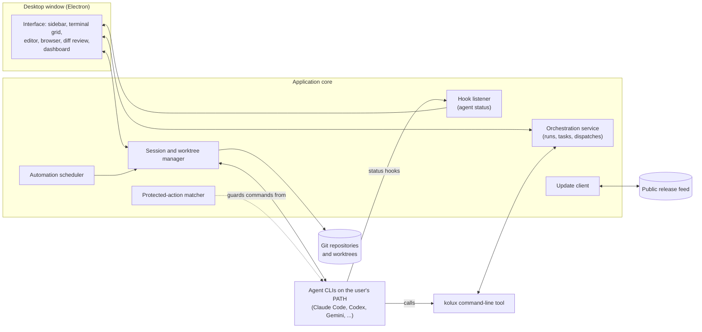
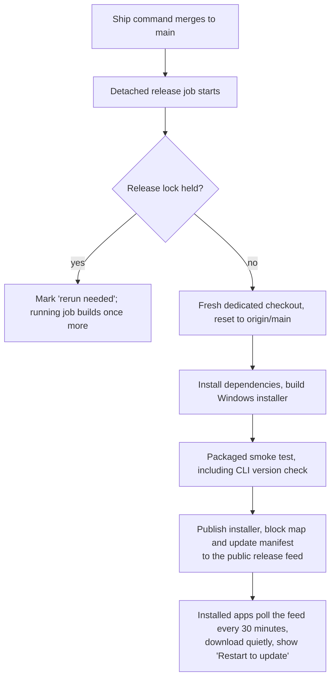

# Kolux: Designing a Desktop Workspace for Running Parallel AI Coding Agents

*Personal software project · Sacramento, California · September – October 2026 · Txais Xiong*

## Abstract

AI coding agents are most useful when several run at once, each on its own task, but agents sharing a single project folder overwrite each other's work, and a separate terminal window per agent makes it hard to see which one needs a human. Kolux is a Windows-first desktop application I designed to solve both problems. Each agent works in its own git worktree (a second, isolated checkout of the same repository), and a single window holds terminals, an editor, a browser and diff review, with live status for every agent and a command-line orchestration tool that lets one agent start and coordinate others. I did not write the code: I wrote specifications, logic and acceptance checks, directed AI coding agents to implement them, and tested each release myself. The repository records 364 commits on 20 distinct days between 2026-09-10 and 2026-10-26, and the public release feed lists v0.15.1 to v0.15.4 (the latest on 2026-10-26). This paper describes the design, the process, and the evidence I have: a read-only audit that found 3 high-severity and 13 medium-severity issues and the fix wave that closed them, a full test run of about 77,700 tests, and one practical lesson. When many agents ran their test suites at once the machine, not the application, was the bottleneck, and capping test workers at two fixed it. The source is private, so I describe architecture and decisions in prose and diagrams only. Some claims rest on my own records, and I flag them.

## 1 Introduction

Software teams now use AI coding agents (command-line programs such as Claude Code, Codex and Gemini CLI that read a codebase, edit files and run commands on instruction). One agent working alone is useful. The larger gain comes from running many in parallel: one fixing a bug, one writing tests, one reviewing a change. Two practical obstacles appear immediately.

1. **Collision.** If two agents edit the same working folder, they overwrite each other, and neither can tell why a file changed under it.
2. **Attention.** Each agent runs in its own terminal. A person supervising six of them cannot see at a glance which are working, which are finished, and which are stopped waiting for a decision only a human can make.

Kolux is my answer to both. Its premise is that the unit of work should be a *session*: one agent, one isolated copy of the project, one terminal, and one visible status. The application's job is to make starting, watching, coordinating and reviewing many sessions as cheap as managing one.

This paper is a design-and-process report, not a product announcement. Kolux is my own tool and a portfolio piece; no pricing or launch is planned (by my account, recorded on 2026-09-29). I wrote it to show how I specify, direct and verify software built with AI assistance, and what measurements I have to support that.

### 1.1 How I build

I want to state my role precisely, because the rest of the paper depends on it. I do not write code. I decide what the system should do, in what order, and what counts as done; I write that down as specifications, logic and acceptance checks; AI coding agents write the implementation, often several at once inside Kolux itself; and I test each release on my own machine, send failures back, and ship. Claims in this paper about what the software does are therefore claims about behaviour I specified and tested, not about code I authored.

## 2 Background and context

### 2.1 Terms used in this paper

| Term | Meaning |
|---|---|
| Git worktree | A second working folder attached to the same git repository, on its own branch, so two people (or agents) can edit "the same project" without touching each other's files |
| Agent CLI | A command-line AI coding assistant that runs in a terminal and uses the user's own account and model subscription |
| Hook | A small script an agent runs at defined moments (for example, "I have finished"), which Kolux uses to learn the agent's state |
| Orchestration | One agent creating work items, starting other agents to do them, and receiving their results |
| Electron | A framework for building desktop applications from web technology; Kolux is an Electron application |
| Test worker | One operating-system process that runs part of an automated test suite; more workers run faster but use more memory and processor time |
| Auto-update | The installed app checking a published feed for a new version and installing it |

### 2.2 Position of the project

Kolux began on 2026-09-10 under the working name Nightshift and was renamed Kolux in release v0.10.0 on 2026-09-22 (new application name, command-line tool name and icon). The product is MIT-licensed. It builds on an existing open-source, MIT-licensed code base, and the licence file retains that project's original copyright notice, as the licence requires. The history I cite begins at my first commit on 2026-09-10; earlier history of the foundation is not part of this repository and is not claimed here. I did not write the foundation, and I do not describe Kolux as written from scratch.

Kolux bundles no AI models and no API keys. It launches the agent tools the user already has installed and pays for, and those tools talk to their own providers under the user's own accounts. The build's own privacy statement says the application sends no usage data (its telemetry transport is compiled off); the only network traffic it initiates is update checks against GitHub Releases.

## 3 Data and sources

This is a software-engineering case study, so its evidence is project records rather than an experiment. I list them, with how much each can be trusted.

| Source | What it gives me | Reliability |
|---|---|---|
| Repository history | Commit counts, commit dates, release tags | High: machine-generated |
| Public release feed | Release versions, dates and notes (v0.15.1 to v0.15.4) | High: published artefacts |
| A read-only audit report (2026-10-04) | Findings by severity, with a statement of what was verified safe | Medium-high: produced by AI auditors with adversarial verification, then checked by me |
| A fix-wave report and a close-out report (2026-10-06) | What was fixed, test and lint outcomes, release published | Medium-high: logs quoted in the reports |
| Project notes and a build log | Feature list, release timeline, direction decisions | Medium: my own record |
| An AI-usage cost analysis (2026-10-13) | Calls, tokens and list-price cost for the original application | Medium: computed from session logs; the dollar figures are equivalents, not bills |
| A resource measurement (2026-09-23) | Memory and processor figures with about nine agents running | Medium: one session, self-reported |

I do not have user-study data, crash statistics or download counts. Kolux has one regular user, me.

## 4 Method and system design

### 4.1 Design goals

I set five goals, in this priority order:

1. Parallel agents must never collide (isolation).
2. The state of every agent must be readable at a glance (visibility).
3. Any agent already installed should work without configuration (openness).
4. Work must be coordinable by agents, not only by me (orchestration).
5. A risky action must stop and ask before it happens (safety).

### 4.2 Architecture

Kolux is organised as four cooperating parts, shown below.

The user interface is a web-technology front end. The application core is a separate process that owns everything with side effects: starting terminals, creating and removing worktrees, listening for agent events. A command-line tool, `kolux`, talks to the core over a local, token-protected channel, which is what lets an agent running inside a terminal drive the application. The source is organised into separate areas for the core, the interface, the command-line tool, a relay for remote hosts and code shared between them. By a file count taken for this paper there are about 21,100 TypeScript source and test files, of which about 8,200 are test files. I give the figure only to indicate scale; it includes the inherited foundation.

### 4.3 Isolation: one worktree per agent

The central design decision is that launching two or more agents on a git repository gives each its own worktree by default. I decided this on 2026-09-24 after a competitor review turned up cases of multi-agent launches silently sharing one folder; sharing stays available but is one deliberate click away. The consequence for the user is that parallel agents cannot overwrite one another, and each agent's changes arrive on a separate branch that can be reviewed in the built-in diff view before merging.

### 4.4 Visibility: status from hooks, not screen-scraping

An alternative way to know what an agent is doing is to read its terminal output and guess. I rejected that as brittle. Kolux instead installs managed hooks into the agent's own configuration, so the agent itself reports whether it is working, waiting on the user, or done. Hook events reach the application through a loopback-only listener (reachable only from the same machine) that requires a per-start secret token; the audit in section 5.2 listed this among the things it verified as safe. Each workspace row in the sidebar then shows the agent and its state (for example "Claude Code, idle"), and a notification fires when an agent finishes.

Two refinements came from use. In v0.12.0 (2026-09-28) I added a *Stopped* state, so an agent halted by a usage limit or an expired sign-in no longer appears as "Done". And an optional agent dashboard, off by default behind an experimental setting, shows every agent across every workspace in three columns: *Needs you*, *Working* and *Done*, with idle agents hidden unless requested. Shipping it off by default had a cost I recorded as a known gap: its keyboard shortcut does nothing until the setting is on, which reads as a broken key rather than a disabled feature.

### 4.5 Launching: shapes, not prompts

The `+` menu lists only agents actually installed on the machine. Beyond single launches, *shapes* (Solo, Pair, Workbench and Swarm) open several sessions at once and assign each a distinct role, with a line-up the user reviews before anything is created. This moves the decision "how many agents, doing what" to launch time, where it is cheapest to make.

### 4.6 Orchestration

The orchestration layer lets one agent coordinate others. Its vocabulary, taken from the skill guide that agents read, is small:

- A **Run** is a durable namespace and a coordinator inbox. It does not schedule or place workers.
- A **Task** is a unit of work.
- A **Dispatch** is one authoritative attempt at a Task.

The guide states an authority rule I consider the most important design choice in this layer: lifecycle authority comes from the active Dispatch, never from a terminal title, a copied identifier or whatever pane happens to be visible. It also separates two liveness questions that are easy to conflate: whether the agent is alive (a fleet-level verdict) and whether its terminal process is alive (a lower-level fact), since "a live terminal can still hold a dead or stuck agent". The default on uncertainty is to preserve work and report the state as unknown; only positive proof of exit permits stopping or retrying. Workers send messages through per-run mailboxes. As of my last handoff note, creating and routing work is still done from the coordinator terminal or command line; the dashboard offers a read-only view of Runs and Tasks. I record that as a deliberate split, not a finished feature.

### 4.7 Further capabilities

These come from my project notes and the public README; I did not independently re-test each for this paper.

| Capability | Behaviour |
|---|---|
| Automations | A prompt runs on a schedule (hourly, daily, cron expression) or when an event occurs |
| Plan review | When an agent proposes a plan, the user comments section by section, then approves it or sends it back |
| Multi-account usage | Several accounts per provider, with usage tracking and a suggestion to switch accounts near a limit |
| Per-session meter | Context percentage and session cost shown in each pane header (v0.15.3) |
| Session resume | Sessions recover after a restart |
| Dictation | Voice input, with a rule that dictated text is never silently lost |
| Auto-update | Described in section 5.4 |

### 4.8 Safety: protected actions

A rule matcher inspects commands an agent is about to run and stops to ask on risky patterns such as force-pushes, database deletions and production deploys. The audit (section 5.2) found that the matcher could be bypassed by wrapper syntax: PowerShell option values parsed as the command, Windows `cmd` switches, and common prefixes such as `sudo -u` or `env -u`. The fix wave closed these, and the matcher's check for patterns that could hang the application was extended to understand character classes.

## 5 Implementation and process

### 5.1 Cadence

The repository shows work in bursts rather than a steady pace.

| Period | Commits | Note |
|---|---|---|
| 2026-09-10 to 2026-09-17 | 87 | First commit under the name Nightshift; six releases (v0.1.0 to v0.4.1) on 2026-09-14 |
| 2026-09-20 to 2026-09-24 | 51 | Rename to Kolux (v0.10.0, 2026-09-22); v0.11.0 on 2026-09-24 |
| 2026-09-28 to 2026-09-30 | 122 | v0.12.0 on 2026-09-28, then work toward later builds |
| 2026-10-04 to 2026-10-26 | 104 | Audit, fix wave, close-out; v0.15.1 to v0.15.4 |
| **Total** | **364** | 20 distinct days with commits |

(Counts are from the commit history by calendar day; I summed the days into the periods above.) Fourteen versions, v0.1.0 to v0.12.0, are tagged in the repository between 2026-09-14 and 2026-09-28. Versions v0.13 to v0.15.0 were built but not published; the public feed begins again at v0.15.1. Of the 364 commits, 208 came after v0.12.0. I keep versions below 1.0 until I decide otherwise.

### 5.2 Verification: audit, fix wave and close-out

The most useful process I ran was a read-only audit on 2026-10-04: six AI auditors (health, two on security, two on correctness, one on over-engineering), followed by two adversarial verifiers whose job was to try to refute every high or medium finding. Nothing was fixed during the audit; the goal was a verified list.

| Result of the audit | Count |
|---|---|
| High-severity (P1) findings, verified | 3 |
| Medium-severity (P2) entries, verified | 13 |
| Lower-severity (P3) items, downgraded or not second-checked | about 13 |
| Dead modules found | 30 modules, 2,091 lines |
| Estimated over-engineering | about 3,900 lines |

The three P1 findings were: a path in a markdown link that could cause the application to contact a network share and leak a Windows credential hash; and two command-matcher bypasses (PowerShell option values and `cmd` switches). Medium findings covered an unauthenticated local browser-debugging proxy, a risky file-open gesture, data-durability gaps (a backup that could overwrite the primary state with no copy, a non-atomic write, a missing retry for a Windows rename error), and relay-protocol faults. The audit also listed what it verified as safe, so that later work would not repeat it; examples were hook listeners bound to loopback with a token, stored secrets never falling back to plaintext, and a sandboxed main window.

On 2026-10-06 a fix wave ran as eight lanes, each following the same pattern: a helper writes regression tests or maps the problem, a lead fixer changes it, a read-only reviewer examines the change, and a repair and re-review follow. About 3,500 lines and 68 files of dead code were removed. The wave landed with v0.15.1. A close-out wave the same day ported security protections from an abandoned branch, and its own read-only review found one high and one medium defect *in the port*, both fixed and re-reviewed before shipping as v0.15.2. The high one was a "symlinked folder" permission that could have exposed a user's secret-key folder; I dropped that permission.

### 5.3 Test evidence

| Check | Result (as reported in the close-out record) |
|---|---|
| Full unit-test run, run alone with worker cap set to 2 | 77,721 tests; 382 failed; 4,353 seconds (about 73 minutes) |
| Re-run of the 72 failing files | 70 passed |
| Two files still failing | Both also failed on the main line before the wave (a Windows permission error in a hook test, and an SSH start-up test) |
| Lint | Exit code 0 |
| Type check | Exit code 0 |

Two points matter. First, on a loaded machine the full suite produced large numbers of spurious failures: in the 2026-10-04 audit run, 6 failures reproduced and about 417 others were load-induced and passed on re-run; in the fix wave, 297 failures in 68 files under load, of which a batch re-run passed 64. Second, I treat a result as good only after the re-run, and I recorded the two known failures instead of hiding them.

### 5.4 Release pipeline

Releases are produced by a single command that merges to the main line and then starts a detached release job.

Design decisions worth noting:

- **Source stays private; installers are public.** Only installers go to the public feed, so every installed copy can poll without credentials.
- **One build at a time.** A lock file prevents two simultaneous builds; a second ship during a build requests exactly one more build from the newest main.
- **Version without a commit.** The next version is the larger of the source version and the latest published tag, plus one patch, injected at build time, so release builds do not clutter history.
- **A real failure shaped the design.** The job originally died with an empty log when started from an agent's shell, because the package manager runs scripts in a process group that is killed when the parent exits, even for detached children. The fix was to start the job through Windows Management Instrumentation, outside that group. The v0.15.4 release (2026-10-26) shipped exactly this fix.
- **Builds are unsigned.** Windows SmartScreen warns on first install ("More info, then Run anyway"). Code signing is an open decision.

## 6 Results

### 6.1 Delivery

| Measure | Value | Source |
|---|---|---|
| First commit | 2026-09-10 | Repository history |
| Latest public release | v0.15.4, 2026-10-26 | Public release feed |
| Commits | 364, by one author identity | Repository history |
| Days with commits | 20 | Repository history |
| Tagged releases through v0.12.0 | 14, between 2026-09-14 and 2026-09-28 | Repository tags |
| Releases in the public feed | 4 (v0.15.1 to v0.15.4) | Public release feed |
| Commits after v0.12.0 | 208 | Repository history |

The single author identity reflects that all commits were made through my account, including those authored by AI agents under my direction; the count does not measure my typing.

### 6.2 Quality and security work

| Measure | Value |
|---|---|
| Audit findings verified: P1 / P2 | 3 / 13 |
| Dead code removed in the fix wave | about 3,500 lines, 68 files |
| Defects caught by read-only review inside the close-out port | 2 (1 high, 1 medium) |
| Full-suite size | 77,721 tests |
| Spurious failures under load (audit run) | about 417 of about 423 failures |

### 6.3 Resource use

On 2026-09-23, with about nine agents running, I measured (self-reported, one session):

| Quantity | Value |
|---|---|
| Kolux's own memory | about 1.5 GB |
| Kolux's own processor use | about a third of one core |
| System memory free | about 1.2 GB of 32 GB |
| System processor use | about 100% |

The load came from the agents' parallel test runs, which started up to four test workers each at roughly 150 to 350 MB per worker, plus a game and a cloud-sync client running on the same machine. I set the environment variable that limits the test runner to two workers, both in the agent tool's settings and as a Windows user variable, which was the fix I applied. I did not log a before-and-after benchmark, so the improvement is my observation, not a measured figure. I did later run the full suite with the same cap to obtain the 77,721-test result above.

### 6.4 Cost of building

An analysis of every AI call across my sessions for the original application (first Nightshift commit to build 0.15.0, 2026-09-10 to 2026-10-08) found about 49,700 calls and roughly 9.4 million output tokens, with a list-price-equivalent cost of about $5,400. The dollar figure is what the same calls would cost at pay-as-you-go prices; I pay a flat subscription, so it is not a bill, but it indicates where my usage limit went. The same analysis, which also covered later work, found that about 71% of spend was agents re-reading long conversations on every call, and only about 4% was newly written text. Length of context, not length of answer, was the cost driver.

## 7 Discussion

### 7.1 What worked

**Isolation as the default.** Making one-worktree-per-agent the default removed the commonest failure of parallel agents. It also made the cost of experimenting low: an abandoned branch is deleted, not repaired.

**Hooks for status.** Having the agent report its own state avoided a class of fragile parsing and made the *Stopped* state possible, which is the state a supervisor most needs to see.

**Adversarial review before fixing.** Separating *finding* from *fixing*, and requiring verifiers to try to refute each finding, produced a list I could trust enough to act on. The review lane inside the fix wave caught real defects in a fix, which supports keeping review independent of the agent that wrote the change.

**A conservative authority model in orchestration.** Giving authority to the active Dispatch, and defaulting to "unknown" rather than acting on partial evidence, trades speed for safety. I prefer that trade when agents can modify code unattended.

### 7.2 Tradeoffs

| Choice | Benefit | Cost |
|---|---|---|
| Default isolation | No collisions | Disk space and a merge step per agent |
| Dashboard off by default | Less clutter for new users | A shortcut that appears broken until the setting is enabled |
| Unsigned installers | No certificate cost or process | SmartScreen warnings |
| Sub-1.0 versions | Honest about maturity | Users may read it as unfinished |
| Orchestration control left in the terminal | Smaller surface to secure | The dashboard cannot yet create or route work |

### 7.3 The bottleneck was the machine

When many agents ran test suites at once, the computer ran out of memory and processor time. The tempting conclusion was that the application was slow. Measuring by process group showed the application used about 1.5 GB and a third of a core; the test workers were the load. The fix lived in configuration, not code. The practice I took from this: measure by process group before changing the application.

## 8 Limitations and threats to validity

- **Single user, single machine.** All verification was on my Windows PC. I have no data on other machines, other users or other Windows configurations.
- **Foundation not mine.** The product builds on an existing open-source code base. Commit counts and dates describe my history of the project and say nothing about the foundation's earlier development, and the file counts in section 4.2 include inherited code.
- **Self-reported records.** Feature descriptions, the resource measurement and the "dictation is never lost" rule come from my notes and specifications. Some were runtime-verified at the time; I did not re-run them for this paper.
- **AI-assisted audit.** The audit used AI reviewers. Adversarial verification reduces, but does not remove, shared blind spots among models. It was not a human penetration test.
- **Test-noise problem.** The suite is noisy on this machine. My practice of re-running failures and listing known failures is transparent but could mask a real intermittent defect.
- **Known unverified items.** My handoff notes list a real browser sign-in flow inside the installed app, and a live hidden-renderer check of some newer interface surfaces, as not yet verified when written.
- **Cost figures.** They are list-price equivalents, cover one phase of the project, and depend on session logs that may be incomplete.
- **No user outcomes.** I have no adoption, retention or productivity data. I cannot say Kolux makes anyone faster; I can say what it does and how it was checked.

## 9 Future work

- Finish the orchestration surface in the dashboard (creating and routing work, not only viewing).
- Resolve the code-signing decision and remove SmartScreen friction.
- Clear the remaining open items from the fix wave: a new browser-debugging connection still evicts an active agent, and the update check should be throttled at launch.
- Remove the remaining duplicate hook-service code paths, which I left in place because their differences are logic, not boilerplate.
- Run a before-and-after benchmark of test-worker caps, so the resource finding becomes a measurement rather than an observation.
- Obtain evidence from users other than me.

## 10 Lessons for practice

1. **Default to isolation.** If several workers can touch one resource, give each its own copy and merge deliberately.
2. **Let the agent report its own state.** Hooks beat parsing output.
3. **Separate finding from fixing, and review the fixes.** Independent verification caught defects in my own security port.
4. **Measure before blaming.** The bottleneck was the machine, not the app; capping test workers at two was a configuration change, not a rewrite.
5. **Record what you did not verify.** A short list of known gaps makes the next session faster and the claims honest.
6. **Context length is the cost.** In AI-assisted building, most spend is re-reading, so short, scoped tasks cost less than long conversations.
7. **Say what you did.** I directed, specified and tested; AI wrote the code. A project record that states this plainly is more useful than one that implies otherwise.

## Sources

1. Project README and privacy statement for Kolux (the build's own documentation), 2026.
2. Project handoff notes, covering known gaps, release procedure and verification limits, 2026.
3. Read-only audit report, 2026-10-04.
4. Fix-wave report, 2026-10-06.
5. Close-out report, 2026-10-06.
6. Release procedure document (automatic updates and release job), 2026.
7. Orchestration skill guide shipped with the application, 2026.
8. Competitor-improvement research notes, 2026-09-24.
9. Repository history and release tags (commit counts, dates, tags).
10. Public release feed at github.com/TxaisX/kolux-releases (versions, dates, release notes).
11. Personal project notes and a build log (feature list, release timeline, direction decisions), 2026.
12. AI-usage cost analysis from my own session logs, 2026-10-13.
13. Resource-bottleneck measurement note, 2026-09-23.
14. Short project page in the public portfolio, github.com/TxaisX/portfolio.
