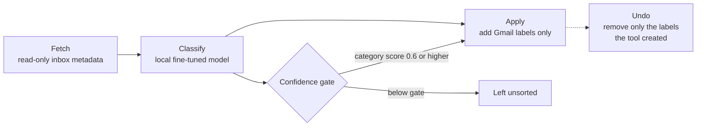

# Laya: A Local, Reversible Gmail Labeler with Confidence Gates

*Personal project · built and run on my own PC · September – October 2026 · Txais Xiong*

## Abstract

By late September 2026 my Gmail inbox held 28,860 threads. Gmail's built-in tabs sorted some of them, but job replies, bills and orders were still buried under promotions, and nothing singled out the few messages that needed me to act. I built Laya, a personal tool that labels the inbox using a fine-tuned classification model that runs locally on my own PC, so no mail is sent to an outside service for sorting. The tool works in four steps: fetch read-only metadata, classify with the local model, apply labels, and undo. It assigns each thread to one of eight categories (Jobs, Money, Orders, Promo, Newsletter, Dev, Events, Accounts) and separately flags action items under 30 days old as "Needs me". Two confidence gates (0.6 for categories, 0.5 for the flag) keep the model from labeling anything it is unsure about. In one run on 2026-09-28, the tool processed 28,860 threads, categorized 22,707 (about 79%), left 6,153 unsorted and flagged 94. It ran daily on my PC from September to October 2026. The local copy was removed on 2026-10-28, and the code is no longer on my disk. I did not measure accuracy against a hand-labeled sample, and the records I kept do not document the base model, the training data or the evaluation. This paper therefore describes a design and a set of coverage counts, not a validated classifier.

## 1 Introduction / problem

An inbox is a queue where the important items and the noise arrive in the same stream. Mine had grown to almost 29,000 threads. Gmail's own category tabs handle part of this, but they did not separate the messages I cared most about: replies to job applications, bills and money-related notices, and order confirmations. Those sat alongside promotions and newsletters. Just as important, nothing surfaced the small number of messages that were waiting on an action from me.

I wanted a tool that would:

1. Sort the whole inbox into a few categories that match how I think about my mail.
2. Mark the items that need me, and only the recent ones.
3. Keep my mail on my own machine during sorting.
4. Be safe to run, and be fully reversible if it made a mistake.

The research question is practical: can a small, locally run, fine-tuned classifier plus confidence thresholds sort a large personal inbox usefully and safely, and what can I honestly say about how well it did?

## 2 Background and context

**Classification and confidence.** A **classifier** is a model that assigns an item to one of a fixed set of categories. Most classifiers also produce a **confidence score**, a number between 0 and 1 that expresses how strongly the model favors its chosen category. A **confidence gate** is a threshold on that score: below it, the tool declines to decide. Gating trades coverage for care. A higher gate labels fewer threads but, in principle, mislabels fewer.

**Fine-tuning.** **Fine-tuning** means taking a model that was already trained on general data and training it further on a narrower task. The project's own documentation describes the model as fine-tuned and local. Section 8 states exactly what I do and do not know about that process.

**Local execution.** Running the model on my own PC means the content of my mail is not sent to a third-party AI service to be sorted. Gmail itself is of course still the mail store; the tool talks to Gmail only through Google's official programming interface (the Gmail API).

**Labels, not folders.** Gmail **labels** are tags attached to a thread. Adding or removing a label does not move, archive or delete the underlying mail. This is the property that makes the tool reversible.

**Privacy of this paper.** This is a public document about a private mailbox. It reports aggregate counts only. It contains no sender names, subjects, addresses or message content.

## 3 Data and sources

**What the tool reads.** The first step fetches inbox **metadata** through a read-only request. My project notes describe it as metadata only; they do not enumerate the fields, and I do not list them here.

**Run data.** The numbers in Section 6 come from one run on 2026-09-28 at 07:00, recorded in the tool's run log and summary file as transcribed in my project notes. A second, later data point (2026-10-04) comes from a vault audit that read the tool's output. I report it as a secondary figure.

**What I do not have.** There is no preserved training set, no labeled evaluation set and no per-thread decision log in the material I used for this paper. The code is no longer on disk (Section 5).

**Sources for this paper:** my project note for Laya, the tool's own code documentation as quoted in that note, an internal audit of my notes dated 2026-10-04, and my earlier short page about the project.

## 4 Method / system design

### 4.1 Four steps

| Step | What it does | What it deliberately does not do |
|---|---|---|
| Fetch | Reads inbox metadata and writes it to a local working file | Does not change anything in Gmail |
| Classify | Runs the local model over the fetched threads and writes its decisions and a run summary to local files | Does not send mail content to an outside service |
| Apply | Creates labels and adds them to threads in Gmail | Does not move, archive or delete any mail |
| Undo | Deletes the labels the tool created | Does not touch the mail itself |

The working files are plain line-delimited text files (one record per line, a format called JSONL).

### 4.2 Categories and the "Needs me" flag

The model assigns each thread to one of eight categories:

| Category | Intended meaning |
|---|---|
| Jobs | Job-search related threads |
| Money | Bills, banking and other money matters |
| Orders | Purchases and deliveries |
| Promo | Promotional mail |
| Newsletter | Subscribed newsletters |
| Dev | Developer and technical services |
| Events | Event-related mail |
| Accounts | Account and sign-in notices |

The one-line meanings are my plain-language summaries of the category names. The label definitions I used while building the tool are not preserved.

Separately, a red **"Needs me"** flag marks action items that are less than 30 days old. The age limit keeps the flag focused on things I can still act on. My notes do not record whether the 30-day cutoff is applied by the model or by a rule after classification, so I do not claim either.

### 4.3 Confidence gates

| Gate | Value | Applies to |
|---|---|---|
| `CAT_GATE` | 0.6 | Assigning one of the eight category labels |
| `ACTION_GATE` | 0.5 | Setting the "Needs me" flag |

A thread whose category confidence falls under 0.6 gets no category label. It stays unsorted rather than risk a wrong label. The action gate is lower (0.5). I did not record my reasoning for the two values in my notes, and I will not reconstruct one. A plausible reading is that a missed action item costs more than an extra flag, so the flag tolerates lower confidence, but that is an interpretation, not a documented decision.

### 4.4 Safety properties

1. **Read-only fetch.** The fetch step cannot alter the mailbox.
2. **Additive apply.** The only write is adding Gmail labels.
3. **Scoped undo.** One command removes the labels the tool itself created, so it cannot disturb labels I made by hand.
4. **Abstain by default.** Below the gate, the tool does nothing.
5. **Local inference.** The model runs on my PC.

The tool needs permission to modify labels on my account. I treat the credentials that grant that permission as secret, which is why the source code was never published (Section 5).

## 5 Implementation and process (how it was built and tested)

**How I build.** By my account, I design the logic and the test cases, an AI assistant writes the code, and I test and iterate until it works. I do not hand-write code, and Laya was built this way. The tool's entry point is a single Python script that exposes the four steps as commands, and its own opening description reads, in part, "Label the whole Gmail inbox with the fine-tuned Laya model."

**Model.** The project describes the classifier as a fine-tuned local classification model, which I refer to as "the Laya model." I do not have a record of which base model it was fine-tuned from, how large the training set was, how the training examples were labeled, or what the training run looked like. I would rather leave those fields blank than guess.

**Testing.** What I can say is limited. Safety was designed in (Section 4.4) and the tool ran against my real mailbox daily. I did not preserve a test plan, and I did not run an accuracy evaluation against hand-labeled threads. The practical test was repeated use: run the tool, look at what it labeled, and reverse it if it misbehaved.

**Operation.** The tool ran every morning at about 7 AM on my PC from September to October 2026. It competed for the PC's graphics processor with other scheduled work, which I noted as an operational cost.

**Retirement.** On 2026-10-28 I removed the local copy from my PC. The code, which held my mail credentials, is therefore no longer on disk, and this paper cannot point to a repository. The design in this paper is as it was documented on 2026-09-28; later revisions of the workflow are not covered.

## 6 Results

### 6.1 One full run, 2026-09-28

| Measure | Count | Share |
|---|---|---|
| Threads in the inbox | 28,860 | 100% |
| Threads categorized | 22,707 | about 79% |
| Threads left unsorted (below the gate) | 6,153 | about 21% |
| Threads flagged "Needs me" | 94 | about 0.3% of all threads |

The categorized and unsorted counts sum to the inbox total (22,707 + 6,153 = 28,860). Whether the 94 flagged threads fall inside the categorized group, the unsorted group or both is not recorded in my notes, so I report their share against the full inbox only.

### 6.2 Category distribution

| Category | Threads | Share of the 22,707 categorized |
|---|---|---|
| Jobs | 5,990 | about 26.4% |
| Promo | 5,372 | about 23.7% |
| Newsletter | 3,368 | about 14.8% |
| Money | 2,900 | about 12.8% |
| Accounts | 2,188 | about 9.6% |
| Orders | 2,095 | about 9.2% |
| Events | 610 | about 2.7% |
| Dev | 184 | about 0.8% |
| Total | 22,707 | 100% |

The category counts sum exactly to the categorized total. Jobs and Promo together account for about half of the labeled threads, which matches the problem I set out to solve: the messages I care about and the promotions that bury them are the two largest groups.

### 6.3 A later snapshot

An audit of my notes dated 2026-10-04 recorded the tool's output as 29,132 threads and 151 "Needs me" flags. Compared with 2026-09-28, that is 272 more threads and 57 more flags in six days. I did not record the categorized and unsorted split for that date. The flag count is a snapshot of open items under 30 days old, so it can rise and fall as items age out or are handled. I draw no conclusion from the change beyond noting that the tool kept running.

### 6.4 What the results do and do not show

They show **coverage**: the tool made a decision on about four in five threads and abstained on about one in five. They do not show **correctness**: a confident label can still be wrong. I have no measured accuracy, precision or recall. I do not know how many of the 22,707 labels were right, nor how many of the 6,153 unsorted threads would have been labeled correctly at a lower gate.

## 7 Discussion

**What worked.** Three design choices did the most for the problem I set out to solve.

1. *Abstaining below the gate.* Roughly one in five threads stayed unsorted. For a personal inbox, I prefer a thread with no label to one with a wrong label, and the gate makes that preference explicit.
2. *Additive labels with a scoped undo.* Because the tool only adds its own labels, the worst case of a bad run was an annoying label set that one command removed. That safety let me run it against a real, 29,000-thread inbox without fear.
3. *Local inference.* Sorting happened on my own hardware, so the content of my mail was not sent out to be classified. For a mailbox that holds job correspondence and financial notices, I considered that non-negotiable.

**A separate flag for action.** Categories answer "what kind of mail is this?" The "Needs me" flag answers a different question: "does this need something from me, and is it still live?" Keeping the two apart, with their own gate and an age limit, meant the flag could stay small (94 threads out of 28,860) and useful.

**Tradeoffs.**

| Choice | Benefit | Cost |
|---|---|---|
| High-ish category gate (0.6) | Fewer wrong labels | About 21% of threads unsorted |
| Lower action gate (0.5) | Fewer missed action items, if the confidence scores are well calibrated | More chance of a false flag |
| Local model | Mail content stays on my PC | Needs my hardware and competes with other jobs for the GPU |
| Labels only | Fully reversible | The inbox is not decluttered, only tagged |

**Unverified assumption.** The tradeoffs in the table assume that the model's confidence scores track real accuracy. I never checked that. Models are often over- or under-confident, so the gate values of 0.6 and 0.5 are choices, not proven optima.

## 8 Limitations and threats to validity

1. **No accuracy measurement.** I did not compare the model's labels against a hand-labeled sample, so I cannot report accuracy, precision or recall for any category or for the flag. This is the most important limitation. The results in Section 6 describe volume and coverage only.
2. **Training details are undocumented.** The records I have do not give the base model, the training-set size, the labeling method for training data, or the evaluation procedure. I describe the model only as the project described it: fine-tuned, local, a classifier.
3. **The code is gone.** The local copy was removed on 2026-10-28, and the source was never published because it held my mail credentials. No one, including me, can re-run or audit the tool from the public record.
4. **Single user, single inbox.** The tool was fitted to one person's mail and one person's idea of the categories. Results may not transfer to another mailbox.
5. **Coverage depends on the gate.** The 79% / 21% split reflects the chosen gate of 0.6 and the model's score distribution. I did not run the tool at other gate values, so I cannot say how sensitive the split is.
6. **Category definitions are informal.** The categories overlap in places (a money notice can also be an account notice). I did not preserve a labeling guide, so I cannot say how the model resolved ambiguity.
7. **Secondary figures.** The 2026-10-04 snapshot comes from an audit of my notes, not from re-reading the run output for this paper.
8. **Self-reported usage.** That the tool ran daily from September to October 2026 is my own account, supported by one dated run record and one later snapshot, not by a complete run history.
9. **Design drift.** The design described here is the 2026-09-28 documentation. Later versions of the workflow are outside this paper.

## 9 Future work

1. **Measure accuracy.** Hand-label a random sample of threads, compare the model's labels with mine, and report precision and recall for each category and for the flag.
2. **Calibrate the gates.** With a labeled sample, check whether a score of 0.6 really corresponds to correct labels about as often as that implies, and set the gates by category based on the evidence. Lower the gate for categories that prove reliable.
3. **Document the model.** Record the base model, the size and sources of the training set, how examples were labeled, and the evaluation results, so a reader could judge them.
4. **Review the abstentions.** Sample the unsorted threads to learn what the model finds hard, and add training examples for those cases.
5. **Track drift.** Log per-run counts so I can see if the share of unsorted threads grows as the mix of incoming mail changes.
6. **Keep the evidence.** Preserve a de-identified version of the code and a labeled test set, with credentials removed, so the work can be reviewed.

## 10 Lessons for practice

1. **Make the tool reversible before making it smart.** Adding labels only, with a scoped undo, made it safe to test on real data at full scale.
2. **Give the model a way to say "I'm not sure."** A confidence gate is a cheap way to convert uncertainty into abstention. Coverage drops, but trust in the labels is higher.
3. **Do not confuse coverage with accuracy.** "79% categorized" says the tool made a decision, not that it was right. I would not present it as a quality score, and neither should anyone else.
4. **Write down the model's provenance.** The most avoidable gap in this project is missing records about the model's training. A short training note would have cost almost nothing at the time.
5. **Keep a labeled sample from day one.** A few hundred hand-labeled threads would have turned this from a design description into an evaluated system.
6. **Treat credentials as part of the design.** A tool that can modify a mailbox holds a powerful permission. Keeping it local and unpublished was a deliberate choice, with the cost that the work cannot be inspected publicly.

## Sources

- Project note for Laya, including the tool's code documentation as quoted in it and the 2026-09-28 run summary (thread counts and per-category counts).
- Internal audit of my notes, dated 2026-10-04 (later thread and flag snapshot).
- My earlier short project page for Laya, from the public portfolio at github.com/TxaisX/portfolio (design summary, consistent with this paper).
- Personal working notes on how I build software with AI assistance.
