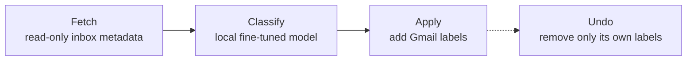

# Laya

**Personal project** · 2026 · Gmail labeler built on a fine-tuned local model (source is private: it holds my mail credentials)

📄 **Full research paper:** [Laya: A Local, Reversible Gmail Labeler with Confidence Gates](laya-paper.md) (about 3,200 words)

## The problem

My inbox had almost 29,000 threads. Gmail's own tabs sorted some of it, but job replies, bills and orders still got buried under promotions, and nothing pointed out the few emails that needed me to act.

## What I built

A four-step tool that runs on my own PC, so no mail leaves the machine for sorting:

- **8 categories:** Jobs, Money, Orders, Promo, Newsletter, Dev, Events, Accounts.
- **A red "Needs me" flag** for action items under 30 days old.
- **Confidence gates:** the model only labels a thread when it is at least 60% sure of the category (50% for the action flag). Anything below stays unsorted rather than mislabeled.
- **Safe by design:** it only adds or removes its own labels. It never moves, archives or deletes mail, and one command undoes everything it did.

## Result

From one run in Sept 2026:

| | |
|---|---|
| Threads in the inbox | 28,860 |
| Labeled | 22,707 (79%) |
| Left unsorted because the model wasn't sure | 6,153 |
| Flagged "Needs me" | 94 |

It ran every morning from September to October 2026.

## What I'd do next

Measure accuracy against a hand-labeled sample instead of trusting the confidence scores, and lower the gate for the categories that prove reliable.
