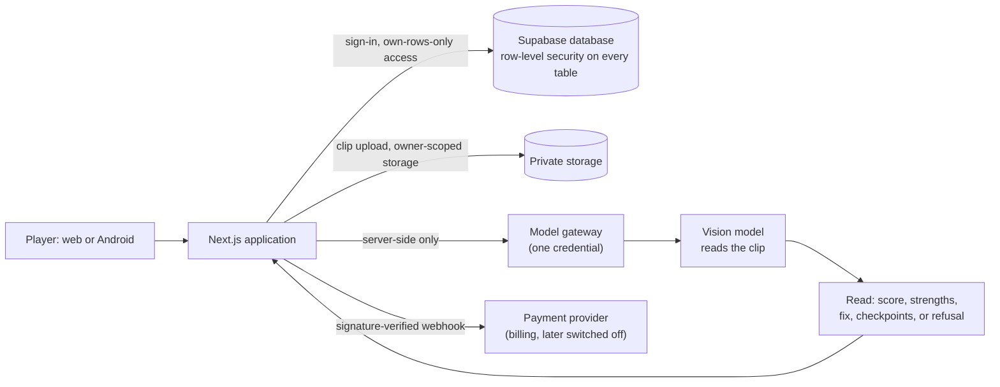

# Vollyio: Measuring an AI Skill Grade and a Market, and Closing the Product

*Personal software project · Sacramento, California · 6 July – 27 August 2026 · Txais Xiong*

## Abstract

Vollyio was a volleyball skill-analysis app for web and Android. A player uploaded a short clip, marked themselves, and a vision model returned a coach-style read of the rep: a score out of 100, strengths, one priority fix and drills. I designed the product, its scoring rules and its tests, and directed AI coding agents to write the code. Over about seven weeks the repository accumulated 363 commits, 127 distinct written decisions and, by the last count in a commit message, 754 passing tests. I then did what I should have done earlier: I measured whether the grade could be trusted and whether anyone would pay for it. On a 415-clip calibration corpus the score had a single-read reliability of 0.64, scored beginner footage almost the same as professional footage (means 81.7 and 83.5), and gave a median of 81 to footage that contained no volleyball rep at all, the same as its median for real reps. In the market, six volleyball graders had launched between February 2025 and June 2026 and the largest had 74 App Store ratings at $9.99 a month. Vollyio itself had 9 accounts, one of them mine, and 0 paying customers. On 27 August 2026 I closed it as a product, kept the site free, and made the source public. The central lesson is procedural: a demand test I had written on 11 August, before posting anything, was never run, while the build continued. Validate demand before the second week of building.

## 1 Introduction

Many people who play volleyball film themselves and wonder whether their technique is any good. A natural product idea follows: let a vision model, an AI system that interprets video, watch the clip and grade it. Vollyio was my attempt at that product.

This paper reports what I built, how I measured it, and why I stopped. It is mainly a paper about evidence. Building the product turned out to be the easy part. The hard questions were whether a number produced by a video model means anything, and whether individual players pay for such a number. I answered both questions late. The record of how I answered them, and the cost of answering late, is the useful part.

### 1.1 How I build

I do not write code. I decide what the system should do and how I will know it works; I write that as decisions, rules and test cases; AI coding agents write the implementation; and I test the result, send failures back and ship. Throughout this paper, statements about what the software does describe behaviour I specified and tested, not code I authored.

### 1.2 Research questions

1. Can a vision model's 0 to 100 score for a volleyball clip be made trustworthy (stable, and able to tell skill levels apart)?
2. Is there evidence that individual players pay for an automated technique grade?
3. How should a solo builder sequence building and validation?

## 2 Background and context

### 2.1 The product

A player uploads a short clip and marks which athlete to analyse. The clip is read once, holistically, against a written rubric (a list of what to look for in a serve, pass, set, attack, block or dig). The model returns a score, what the player did well, what to fix, and which of five checkpoints the footage actually showed. The model is called through a server-side gateway; the player's browser never sees any credential. There is no on-device machine learning.

The product ran as a web application (Next.js, a web framework, with a Supabase database and sign-in service, deployed on Vercel) and as an Android app wrapping the web product. The Android code lives in a separate private repository; the web repository is public.

### 2.2 Terms

| Term | Meaning |
|---|---|
| Reliability | How much of the variation in scores comes from the clips rather than from random noise. Reading the same clip twice and getting similar scores means high reliability. Here it is the correlation between a first and second read of the same clips |
| Calibration | Adjusting a score scale so numbers mean something consistent against known-good labels |
| Corpus | The set of clips used to test the system |
| Label | A human judgement about a clip, recorded without showing the model's score |
| Row-level security (RLS) | A database rule that lets a signed-in user read and change only rows they own |
| Rep | One attempt at a skill, such as a single serve |
| Frame sampling | The model sees a video as still images taken at intervals, not as continuous motion |
| Pro plan | The paid tier (never successful; see section 6) |

### 2.3 Timeline

| Date (2026) | Event |
|---|---|
| 6 July | First commit |
| 11 August | A repository audit found 4 real users, 129 visitors in 30 days and $0 external revenue; I wrote a demand test and committed to running it |
| 13 August | First calibration run over 47 production clips, then a 415-clip corpus |
| 21 August | Rep gate shipped (decision D-126) |
| 27 August | Product closed (decision D-131); free model attempted and reinstated behind a normalizer (D-132) |

## 3 Data and sources

The repository is public (github.com/TxaisX/vollyio, live at vollyio.com), so each source below can be read by anyone. I list what each gave me and how far to trust it.

| Source | Content | Notes on reliability |
|---|---|---|
| Decision log | 127 distinct decisions (numbered D-001 to D-132, with gaps), each recording what was measured, what it cost and why. D-027 onward describes the current system | Written by me and my agents at the time; includes entries later marked wrong |
| Calibration document | Method and results over a 415-clip corpus | Measured; clip files themselves are not published |
| Business-position document | Account, usage and cost figures read from the live database on 19 August | Read, not estimated; some numbers rest on very few rows |
| Demand-test document | The pre-registered test written 11 August | A plan, not a result |
| Security document | Who may call what, and the checks that prove a player cannot grant themselves a plan | Process document |
| My research note on the market (27 August) | Competitor counts, ratings and prices | Desk research from public listings; not independently audited |

**Corpus.** 415 clips: 47 uploaded by real players, and 368 cut blind (eight-second windows chosen without looking for a rep) from public footage ranging from beginner tutorials to Olympic highlights, 57 to 80 per skill. The corpus document reports 180 clips scored and 234 refused; those two figures sum to 414, and I cannot account for the 415th from the document. Player clips and sourced footage are not published.

**Counts.** The brief that started this paper quoted 357 commits. The public history now shows 363 (362 through 27 August plus one automated snapshot on 28 August); I cannot reconstruct what the earlier tally of 357 counted, so I use the current figure. The 127 decisions are distinct decision identifiers in the log. The 754 test count comes from the message of a commit on 21 August ("754 tests 0 fail"); I did not re-run the suite for this paper, and the final count may differ.

## 4 Method and system design

### 4.1 System design

Three design rules did most of the work:

- **Authorization lives in the database.** Row-level security is on every table, and routes repeat the ownership check as defence in depth. Exactly one module can bypass it, and the security document records each of its four callers with a reason. A player cannot change their own plan, because the permission to update that column was never granted; only a signature-verified payment webhook can.
- **Fail closed.** A payment or configuration problem returns an error and changes nothing. There is no "skip verification when unconfigured" path.
- **One provider, two jobs.** After a refactor (D-098) the application used a single gateway credential, with one model id for reading pixels and one for writing text.

### 4.2 Measurement design

The measurement loop was a set of scripts that replayed the exact shipped prompt against a corpus and recorded raw scores. Its rules were:

1. **Calibrate against labels, never against prompt wording** (D-034). Re-anchoring the same model by prompt three times in one week moved its median 55, 78, then 97, while its rank correlation with labels stayed at 0.708. The model knew which rep was better; it did not know where to put the number. Placement therefore belongs in code, against anchors a coach sets.
2. **Blind labelling.** The labelling tool never shows the model's score, because a reviewer who can see 78 writes 78. Labels use the rubric's own ten bands plus "cannot rate", which counts as a label, not a skipped clip.
3. **Name the subject.** Production always tells the model which player to analyse, so the test harness had to send the same marker. Until 13 August it did not, which let two models grade two different people and call the difference disagreement.
4. **Release gates.** A gate in code refuses a scale whose noise is not below its signal.
5. **Test the measurement.** Tests assert that the shipped rep-gate wording equals the measured variant file, so the record and the product cannot drift apart.

### 4.3 Market research design

I counted volleyball graders launched between February 2025 and June 2026, recorded their prices and public ratings, and looked at what the volleyball and wider sports-analysis products with traction actually sell. I treated Vollyio's own database as the demand evidence, reading usage numbers from it instead of estimating.

## 5 Implementation and process

### 5.1 Pace

The repository shows steady, heavy building, with bursts.

| Week beginning (Monday) | Commits |
|---|---|
| 6 July | 109 |
| 13 July | 21 |
| 20 July | 59 |
| 27 July | 48 |
| 3 August | 38 |
| 10 August | 31 |
| 17 August | 36 |
| 24 August | 21 |
| **Total** | **363** |

(I summed commits by calendar date into Monday-to-Sunday weeks.) The busiest single day, 12 July, had 42 commits.

### 5.2 What was built

By the 11 August audit the product had 15 database tables, 60 migrations, 630 tests, six skills (serve, pass, set, attack, block, dig), coach chat, weekly plans, progress tracking, billing, an installable web app, an Android build and a Play Store listing one upload from complete. Later work added an analysis-first signup funnel (D-118), a rep gate that refuses clips with no rep (D-126), and an experimental retrieval index (D-130). Content pages (injury entries, drills, skill pages) numbered 77 by 19 August.

### 5.3 Security and billing verification

Because the product took payments, I wrote the access-control rules before connecting a payment provider. The security document specifies a sequence of live checks to run as an ordinary signed-in test player: a direct write to the plan column must fail with a privilege error; calling the plan-setting database function directly must be denied; a forged webhook (no signature, wrong secret, expired timestamp, valid signature over different bytes) must return an error and leave the plan untouched; removing the webhook secret must make the endpoint reject everything rather than trust the request. The document states why these are live checks: "a passing typecheck is not a denied write." One production defect (a reservation-link bug) reached production precisely because tests could not exercise live permissions, and the document records this.

I should be clear about the limits of this evidence: the document is a plan and a record of rules; I have not re-run the checks for this paper.

### 5.4 Cost measurement

D-106 read the cost of a completed analysis out of production telemetry. It was $0.0164, 46% lower than the $0.024 that earlier documents had used, and about 70% of it was the model's written output, not the footage. The sample behind this was small: four analyses, all mine. Fixed hosting cost was about $54.50 a month on 19 August.

## 6 Results

### 6.1 Is the grade trustworthy?

**Spread.** On 47 real player clips replayed through the shipped prompt, 45 were scored: minimum 71, median 78, maximum 92, standard deviation 5.0. The scale used 21 of its 100 points, so every rep came back "Solid" or "Advanced."

**Skill separation.** Mean raw score by the footage's own level (from the 415-clip corpus):

| Footage level | Mean score |
|---|---|
| Developing (beginner tutorials) | 81.7 |
| Intermediate | 80.2 |
| Advanced | 81.9 |
| Pro | 83.5 |

The highest score in the corpus, 96, went to a window cut from an instructional video that, on closer review, was a static multi-exposure graphic (a title card).

**Reliability.** Re-reading 61 clips three times each gave a single-read reliability of 0.64. Averaging reads improves it, at a cost:

| Reads averaged | Reliability | Cost per analysis |
|---|---|---|
| 1 (shipped) | 0.64 | $0.0164 |
| 2 | 0.78 | $0.0328 |
| 3 | 0.84 | $0.0492 |
| 5 | 0.90 | $0.0820 |

On a smaller 13-clip check, within-clip noise (standard deviation 3.5) was large next to between-clip spread (5.9): roughly a third of what a player sees is the same clip read twice. Averaging three reads left the levels flat (developing 80.5, intermediate 79.7, advanced 82.2, pro 84.8). Averaging removes noise; it cannot create an ordering the judgement never contained.

**Footage with no rep.** I reviewed all 180 scored clips frame by frame. 113 (62%) contained no gradeable rep: coverage of play such as matches and warm-ups (about 40% of those), graphics and title cards (about 30%), shadow drills with no ball (about 10%), presenters talking (about 10%) and others. The shipped refusal rule caught 1 of the 113. Scores given to non-reps had minimum 48, median 81 and maximum 96. Among 34 labelled production clips, 13 (38%) were non-reps, including a phone screen recording scored 72. For the 68 real reps, the model's bias was about +16.6 points high.

**Rep gate.** Rewriting the refusal rule changed accuracy over the 181 labelled clips:

| Rule | Non-reps refused | Good clips wrongly refused | Correct |
|---|---|---|---|
| As shipped | 1 of 113 | 0 of 68 | 69 of 181 (38%) |
| Variant v4 | 83 of 113 | 12 of 68 | 139 of 181 (77%) |
| Variant v7 (shipped) | 73 of 113 | 6 of 68 | 135 of 181 (75%) |

I shipped v7 because a false refusal costs a player a rep they filmed correctly, and 6 of 68 is within reach of a 5% target where 12 of 68 is not.

**Other readers.** A stronger model (the "pro" tier) used the scale (standard deviation 21.4 against 7.9 on 40 clips), refused more, and had test-retest correlation of 0.71 against 0.64, but it was not simply right. Compared with frame-by-frame reading it gave confident wrong low scores on two real attack clips, and it scored two byte-identical uploads 42 and 73. Neither reader was validated. A later swap to a cheaper model (D-128) was made on price alone and the bakeoff showed it compressed the scale more (range 13 points, standard deviation 3.1).

**Giving the model more frames.** Slowing clips to a quarter speed raised the frames delivered about 4.5 times (mean video tokens 672 to 3,010) for about 21% more cost. Scores rose by a mean of 2.26 points and became tighter (range 12 to 10). More evidence made the model more uniform, not more discriminating (D-129).

**Why calibration could not rescue it.** Of 25 clips labelled from frames, 12 were "cannot rate"; the 13 scorable ones fell into only four distinct bands (60, 70, 80 and 89, mostly 60), so there was no low end to fit a scale to. The corpus held almost no gradeable bad reps.

### 6.2 Is there demand?

My market note (27 August) and the decision log record:

| Finding | Value |
|---|---|
| Volleyball graders launched, Feb 2025 to Jun 2026 | 6 |
| Largest: VolleyVision | $9.99/month, 74 App Store ratings; the rest 0 to 9 |
| Balltime | 125,000 athletes; sold to Hudl; sells match stats and highlights, not technique grades |
| Flex AI | Shut down in March 2026 (reported in the log as about a million users) |
| What players demonstrably pay for | Human coaching: lessons at $40 to $100 an hour, film review at $150 a session |
| Vollyio Pro price | $29.99/month (also weekly $7.99 and a $19.99 exit rate), about three times the most expensive grader with buyers |

My own numbers on 27 August:

| Measure | Value |
|---|---|
| Accounts | 9, one of them mine |
| Signups in last 7 days | 0 |
| Analyses, lifetime | 59 (41 mine) |
| Strangers who returned a second time | 1 of 8 |
| Paying customers | 0 |
| Visitors per week | 105 at the late-July peak; 10 in the last week |
| Break-even | 3 Pro subscribers (about $19.96 margin each against about $54.50 fixed) |
| Model spend | about $1.36 a month |

**The payment-path caveat.** On 12 August I found that both Stripe prices were inactive, so no checkout had been possible for as long as that had been true (D-119). I wrote that "$0 lifetime revenue" was therefore not evidence about demand, and fixed it. Fifteen days later there were still 0 paying strangers, now with a working checkout. The one earlier charge, on my own card, had been cancelled within about five hours (per the 11 August test document), and the 19 August document notes the only subscription on record was mine.

### 6.3 The demand test that was not run

On 11 August I wrote a test before posting anything: post one real breakdown where players discuss technique, disclosed as my own work and with no signup request; decide in advance what each outcome means; change nothing in the product meanwhile. The channel was chosen from one observation: a single share link had brought 74 of the first 219 visitors, about 34%. The document ends by naming the failure it expected, which is returning to the backlog because the backlog is more comfortable than the answer. By my verdict note, between 11 and 27 August the repository gained 11 decisions, ten Android releases, the 415-clip corpus and a redesign, and the post was never made.

### 6.4 Disposition

On 27 August I closed Vollyio as a product (D-131). Billing is switched off by configuration, the landing page and terms describe one free plan, hosting moved to free tiers, and the repository became public and source-available: it may be read and studied, and its licence forbids deploying, redistributing or commercial use. Before publishing, I removed third-party tester addresses from the entire history. D-132 then put a free model behind a normalizer that maps its field spellings onto the product's schema without inventing values. Measured beforehand, about three of five reads were usable; the remaining failures were the free endpoint's own errors. I accepted that players would see "try again" more often.

## 7 Discussion

### 7.1 What worked

**Written decisions with numbers.** Every change recorded what was measured and what it cost, including wrong ones. That record is what made this paper, and the closure itself, possible to write with confidence.

**Measuring the measurement.** Blind labels, a named subject, a calibration rule against label rank and gates in code caught several of my own errors: two labels I had got wrong because I inferred a rep from motion without seeing a ball, a harness that omitted the subject marker, and a wider score histogram that was wider but wrong.

**Security as a written contract.** Putting access rules in the database and recording each exception kept the payment path small and checkable.

### 7.2 What did not

**Treating a score as a measurement.** A number from a vision model felt precise because the interface displayed it to the point. The measurements showed a compressed, noisy and biased scale that could not tell a rep from a graphic.

**Building ahead of the question.** My 11 August audit already showed the binding constraint was demand. I wrote the test and then did not run it. The corpus and the rep gate were good work, and they answered a question that did not decide whether the product should exist.

**A broken payment path.** I read "$0 revenue" as a demand signal for some time while checkout could not have worked. This is the kind of unmeasured assumption that the decision log exists to catch; here it caught it late.

### 7.3 Why the grade is hard

The gateway samples video at about one low-resolution frame a second, and a ball contact lasts about 50 milliseconds. At that sampling a model often sees no contact at all. Slower playback delivered more frames and did not help, which indicates the limitation is not only information. Every sports product whose grade players trust, per my market note, either validated against lab motion capture with a funded team, ran a proprietary pose-estimation team with university partners, or put a human on every report. One person working in evenings on a general video model had none of those.

### 7.4 Tradeoffs in closing

| Option | For | Against |
|---|---|---|
| Keep selling | Revenue possible | The grade is not defensible; 0 buyers |
| Switch the analysis off | No bad scores | Loses the working demonstration |
| Keep it free, public, source-available | Portfolio value; honest record | Free tiers pause on inactivity; some failed reads |

## 8 Limitations and threats to validity

- **Small samples.** The cost per analysis rests on four analyses, all mine. The reliability figures rest on 13 and 61 clips. The 9-account and 1-of-8-returning figures are tiny, though tiny in the direction that matters: there was no traffic to measure.
- **No coach labels.** No coach ever labelled a clip. All labels are mine, or my AI assistant's frame-by-frame judgement, and I found two of my own labels wrong. Level labels come from the source video's description, which is a claim about the athlete, not the eight seconds shown.
- **Non-representative corpus.** Production footage was a handful of recreational players of similar standard; sourced footage skewed to presenters and graphics. The corpus contains almost no gradeable bad reps, so I could not test whether bad reps score badly.
- **Self-reported market research.** The competitor counts and prices are from public listings that I gathered once. App Store ratings undercount users. I did not interview players or coaches.
- **Counting differences.** The commit count differs from an earlier quoted figure (357 against 363), the test count rests on one commit message, and the corpus figures sum to 414 not 415.
- **Short window.** Seven weeks, and the last two with a drifting focus. A demand test that was never run leaves the demand question unanswered by experiment; my evidence is observational.
- **Single builder.** All measurements and judgements are mine, with AI assistance; there was no independent replication.

## 9 Future work

What would reopen the question, as recorded in D-131, is a stranger paying or a coach willing to put their name on reviews, the human-in-the-loop shape every product with traction converged on. Neither is expected. If I returned to the technical question, I would:

1. Collect real beginners filmed at club practice, not tutorials about beginners, until about twenty gradeable reps spread from poor to excellent are labelled by a coach.
2. Rank-correlate the model's ordering against those coach labels before fitting any scale, since a monotone map can only widen what exists.
3. Test the cheaper, narrower claim: a model that tells a player which of their own reps was best, without claiming an absolute grade.
4. Run the demand test first, in a day, before any of the above.

## 10 Lessons for practice

1. **Validate demand before the second week of building.** One post where players gather would have answered what seven weeks of features could not.
2. **Write the test before the result, then obey it.** Pre-registering what each outcome means only helps if you run it.
3. **Measure the instrument.** A displayed number is not a measurement. Check spread, repeat reads, and whether it separates cases it should separate, before building on it.
4. **Do not tune with prose.** Put calibration against labels in code, so a wording change cannot masquerade as progress.
5. **Check the unglamorous path.** A checkout that could not work made "no revenue" meaningless for weeks.
6. **Distrust a wider histogram.** Wide is not correct; verify against the footage.
7. **Make the stopping decision cheap to take.** I closed the product with the numbers in front of me and kept a public record. Stopping with evidence is a result, not a failure.

## Sources

1. Project README and licence, public repository, 2026.
2. Decision log, entries D-027 to D-132 (cost analysis D-106; scale rule D-034; rep gate D-126; model bakeoff D-128; frame test D-129; retrieval index D-130; closure D-131; free model D-132; payment prices D-119), 2026.
3. Calibration document: measurement method and results over a 415-clip corpus, August 2026.
4. Business-position document, read from the live database, 19 August 2026.
5. Demand-test document, written 11 August 2026 (amended 13 August).
6. Security and access-control document, 2026.
7. Personal research note and verdict on the market and closure, 27 August 2026.
8. Repository commit history, 6 July to 28 August 2026 (commit counts and dates).
9. Short project page in the public portfolio, github.com/TxaisX/portfolio.
10. Public site, vollyio.com, and public repository, github.com/TxaisX/vollyio.
