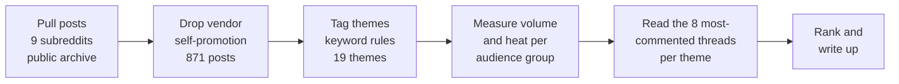

# What the Construction Trades Struggle With: An Analysis of 68,341 Public Reddit Posts

*Independent researcher · public Reddit data, 11 April to 11 October 2026 · analysis completed 11 October 2026 · Txais Xiong*

## Abstract

Construction workers, contractors and the homeowners who hire them talk about their problems in public online forums, but no one reads that volume of conversation by hand. I studied 68,341 public posts from nine construction-related subreddits (Reddit's topic communities) between 11 April and 11 October 2026, pulled from the Arctic Shift public archive. I removed 871 posts in which vendors promoted their own products, tagged the remaining posts by keyword into 19 themes, and measured each theme two ways: *volume* (how many posts touch it) and *heat* (the median number of comments on those posts, against a baseline of 4 for an average post). I analyzed trade professionals (28,786 posts) and homeowner-heavy communities (39,555 posts) separately. For workers, bad management, breaking into the trade and the toll on the body were the largest themes, while pay and burnout drew the most discussion per post (median 11 and 13 comments). For owners and contractors, customers balking at price drew the hottest discussion; looking for customers drew the least (median 4, the baseline). Homeowners mostly asked whether a quote or a repair was fair. The method is approximate: I read post text but not comments, and keyword tagging has known false matches. The counts show rough volume; the linked threads are the evidence.

## 1 Introduction

The construction trades have well-known structural problems, such as an aging workforce, thin margins and a heavy physical toll. Less is written about what people inside the trades say bothers them most *in their own words*, and which of those problems provoke the most discussion rather than merely the most mentions.

My question was simple: **what are people in the construction subreddits struggling with most?**

Two design choices follow from that question:

1. **Volume alone misleads.** A topic can be mentioned often without being a real pain point. A rarely mentioned topic can pull enormous discussions every time it appears. I therefore measured both how often a theme appears and how hard people pile into it.
2. **The audiences differ.** A crew member asking about unpaid overtime and a homeowner asking whether a roofing quote is a rip-off are not the same population. I counted them separately.

I do not claim these forums represent the whole industry. I claim a reproducible read of what a large public sample says, with its limits stated.

## 2 Background and context

**Reddit** is organized into subreddits, each a topic community. Several have grown into working forums for trades: electricians trade career advice, contractors compare notes on pricing and clients, and homeowners ask for second opinions.

**Archive access.** Reddit blocked automated access to its own pages and data endpoints from my machine (an "HTTP 403 Blocked" response), and one other public archive refused automated agents. The Arctic Shift archive, a public archive of Reddit posts, did work, so I used it. Earlier research I had done could only reach Reddit through third-party blog summaries; this was the first pass in which I read the posts directly.

**Terms used in this paper.**

- **Theme.** A topic bucket defined by a set of keyword patterns (section 4.3).
- **Volume.** The number of posts tagged to a theme.
- **Heat.** The median comment count of the posts in a theme. The median is the middle value, so a handful of viral threads cannot inflate it the way an average would. I compare it to the baseline, which is the median comment count across all analyzed posts: 4 in both audience groups.
- **Vendor self-promotion.** Posts where someone announces their own product ("I built an app"), as distinct from someone describing a problem.

## 3 Data and sources

### 3.1 Scope

| Property | Value |
|---|---|
| Source | Arctic Shift public Reddit archive |
| Window | 11 April 2026 to 11 October 2026 |
| Subreddits | 9 |
| Posts pulled | 68,341 |
| Vendor posts removed | 871 (630 in the trade-pro group, 241 in the homeowner-heavy group) |
| Posts analyzed | 67,470 (derived: 68,341 minus 871) |
| Fields kept | Subreddit, post ID, title, first 1,500 characters of body text, score, comment count, timestamp |

Post author names were requested from the archive in the download query but were not saved to the working data, and no usernames appear in this paper.

### 3.2 The two audience groups

| Group | Subreddits (posts pulled) | Total | Who is talking |
|---|---|---|---|
| Trade professionals | Construction 9,022 · electricians 7,291 · Carpentry 5,702 · Contractor 2,809 · ConstructionManagers 2,457 · GeneralContractor 1,505 | 28,786 | Workers, apprentices, owners and project managers. Contractor and Carpentry also draw many homeowners. |
| Homeowner-heavy | Plumbing 25,336 · Roofing 8,040 · HVAC 6,179 | 39,555 | Mostly homeowners asking repair and "is this right?" questions. Professionals post here too. |

One subreddit, Plumbing, supplies about 37 percent of all posts (25,336 of 68,341). I return to the effect of that imbalance in section 8.

### 3.3 What was not collected

I did not read comments, only post titles and bodies. Post scores in the archive are captured close to posting time and sit near zero, so I did not use them. Comment *counts* are more reliable but are snapshots, so posts from the last days of the window are undercounted.

## 4 Method

### 4.1 Pipeline

### 4.2 Removing vendor posts

A single pattern matched typical self-promotion phrasing in the title or body: announcements such as "I built / made / created a ...", "we are building", "founder", "our app / platform / tool", "beta", "waitlist", "SaaS", "looking for feedback / testers", "DM me", "free trial" and "survey". About 2.2 percent of trade-pro posts (630 of 28,786) and 0.6 percent of homeowner-heavy posts (241 of 39,555) matched. These are derived percentages. Because the pattern is blunt, some genuine posts containing words like "survey" or "beta" may have been dropped; I did not measure how many.

### 4.3 Keyword theme tagging

Each post's title and body were lower-cased and tested against one pattern per theme. A post can match several themes. The tagger's own header describes it as "crude but auditable", which is the trade-off I chose: a transparent rule I can inspect and re-run, rather than a model whose reasoning I cannot see. The patterns are written as regular expressions (compact search patterns); the table below lists the substance of each.

| Theme | What the pattern looks for (abridged) |
|---|---|
| Getting paid | "won't pay", "refused to pay", "not paid", non-payment, mechanic's lien, collections, stiffed, small claims, retainage, pay application, chargeback |
| Finding customers and marketing | "lead(s)", Angi, HomeAdvisor, Thumbtack, marketing, Google ads, SEO, advertising, "more customers / clients / work", word of mouth, referrals |
| Pricing and bidding | bid, bidding, "how much should I charge", underbid, lowball, markup, margin, overhead, pricing |
| Hiring and labor | hiring, "can't find good help / workers", labor shortage, no-call / no-show, retaining workers |
| Difficult clients | scope creep, change orders, "nightmare client", micromanaging, red flags, bad review |
| Licensing and insurance | license, insurance, bond, workers' comp, LLC, liability |
| Permits and inspection | permit, inspector, inspection |
| Going independent | "starting my own business", "going out on my own", self-employed, side work, 1099, sole proprietor |
| Software and admin | software, CRM, Jobber, Housecall, ServiceTitan, Procore, QuickBooks, Buildertrend, paperwork, bookkeeping, invoicing |
| Wages | underpaid, wage, raise, pay rate, dollars-per-hour expressions, hourly, union versus non-union |
| Body and safety | back pain or injury, knees, injury, pain, OSHA, safety, heat stroke, hearing, fell, fall, died, killed, fatal |
| Burnout and quitting | burnout, quit, "leaving the trades", "hate my job", depression, mental health, career change, exhausted, 60 / 70 / 80+ hours |
| Bosses and management | boss, foreman, superintendent, toxic, fired, laid off, layoffs, PM, project manager, "my company / employer" |
| Entry and career | apprentice, journeyman, trade school, "getting into the trades", "is it worth", switching careers |
| Slow economy | "work is slow", "no work", economy, tariff, material or lumber prices, recession, backlog |
| AI and technology | AI, ChatGPT, automation, robot |
| Quote and cost shock | "is this quote fair", ripped off, overcharged, fair price, price gouging, "got three quotes", too expensive, "how much should this cost" |
| Bad workmanship | botched, bad job, shoddy, not up to code, hack job, warranty, scam |
| Homeowner versus contractor | "my contractor", "hired a contractor", ghosted, "homeowner here", "we hired" |

For each theme and each audience group the tagger reported: posts, share of the group's analyzed posts, total comments, median comments (heat), and the split across subreddits. It also wrote out the eight most-commented posts per theme with links, which I read to judge whether the counts reflected real complaints.

### 4.4 Ranking

The synthesis ranks themes within the worker and owner lists by weighing volume and heat together. I did not use a fixed formula, so the ordering is a judgment, and the reader can re-rank from the tables in section 6.

## 5 Implementation and process

I specified the question, the two-audience split, the heat measure and the rule that counts are only rough evidence. AI wrote the two scripts, a downloader and a tagger, to my specification. I ran them, read the output and the example threads, and iterated.

**Downloader.** It requests posts for each subreddit and the date window, 50 posts per page, newest first, and writes them to a local file. The page size matters: asking for 100 per page timed out on the largest subreddits. It pauses 1.2 seconds between requests, retries up to six times with growing waits on errors, and skips subreddits already downloaded, so an interrupted run can resume. A full nine-subreddit, six-month pull took about 70 minutes. The 33 MB raw file is not published; re-running the downloader rebuilds it.

**Tagger.** It loads the file, removes vendor posts, tags themes, and prints the count table and example lists described in section 4.3. Its header notes that the reader should read the examples before trusting any count.

**How I checked it.** I did not compute a precision or recall figure, because I had no hand-labeled sample. The check was reading the top threads under each theme and confirming they were about the named struggle. That check caught one mismatch pattern I note below (the lead-electrician problem). I also confirmed the arithmetic: the two groups' post totals sum to 68,341, the two vendor counts sum to 871, and the reported theme percentages match the counts divided by each group's analyzed total.

## 6 Results

### 6.1 Theme volume and heat, trade professionals

Analyzed posts: 28,156 (28,786 pulled, 630 vendor posts removed). Baseline median: 4 comments.

| Theme | Posts | Share | Heat (median comments) |
|---|---|---|---|
| Entry and career | 1,939 | 6.9% | 9 |
| Bosses and management | 1,840 | 6.5% | 10 |
| Body and safety | 1,423 | 5.1% | 6 |
| Licensing and insurance | 1,349 | 4.8% | 5 |
| Finding customers and marketing | 1,200 | 4.3% | 4 |
| Software and admin | 1,095 | 3.9% | 3 |
| Pricing and bidding | 977 | 3.5% | 6 |
| Wages | 786 | 2.8% | 11 |
| Permits and inspection | 731 | 2.6% | 5 |
| AI and technology | 555 | 2.0% | 4 |
| Burnout and quitting | 403 | 1.4% | **13** |
| Hiring and labor | 372 | 1.3% | 5 |
| Going independent | 316 | 1.1% | 8 |
| Difficult clients | 283 | 1.0% | 6 |
| Homeowner versus contractor | 268 | 1.0% | 11 |
| Bad workmanship | 237 | 0.8% | 8 |
| Getting paid | 187 | 0.7% | 5 |
| Quote and cost shock | 138 | 0.5% | 12 |
| Slow economy | 136 | 0.5% | 7 |

Entry and career is concentrated in one community: 1,381 of its 1,939 posts are in the electricians subreddit.

### 6.2 Theme volume and heat, homeowner-heavy subreddits

Analyzed posts: 39,314 (39,555 pulled, 241 removed). Baseline median: 4 comments.

| Theme | Posts | Share | Heat |
|---|---|---|---|
| Permits and inspection | 1,003 | 2.6% | 5 |
| Body and safety | 966 | 2.5% | 5 |
| Finding customers and marketing | 810 | 2.1% | 4 |
| Licensing and insurance | 765 | 1.9% | 6 |
| Bad workmanship | 647 | 1.6% | 7 |
| Entry and career | 610 | 1.6% | 7 |
| Bosses and management | 400 | 1.0% | 11 |
| Homeowner versus contractor | 281 | 0.7% | 7 |
| Pricing and bidding | 274 | 0.7% | 6 |
| AI and technology | 261 | 0.7% | 4 |
| Wages | 258 | 0.7% | 6 |
| Software and admin | 223 | 0.6% | 3 |
| Quote and cost shock | 216 | 0.5% | 10 |
| Burnout and quitting | 160 | 0.4% | 7 |
| Hiring and labor | 148 | 0.4% | 4 |
| Difficult clients | 101 | 0.3% | 8 |
| Going independent | 64 | 0.2% | 10 |
| Slow economy | 56 | 0.1% | 6 |
| Getting paid | 51 | 0.1% | 8 |

### 6.3 Findings for people who work for someone else

| Rank | Struggle | Posts | Heat | Example thread (public) |
|---|---|---|---|---|
| 1 | Bad bosses and management | 1,840 | 10 (2.5 times baseline) | An apprentice told to work unpaid Fridays to pay off a mistake: 2,734 comments, the most-discussed post in the entire dataset ([thread](https://reddit.com/r/electricians/comments/1sxk5w9)) |
| 2 | Breaking in and getting ahead | 1,939 | 9 | A second-year apprentice asking how anyone reaches $100k without a union: 592 comments ([thread](https://reddit.com/r/electricians/comments/1vwalrj)) |
| 3 | Body wearing out, and safety | 1,423 | 6 | "What does everyone in construction do when they hit 30?": 293 comments ([thread](https://reddit.com/r/Construction/comments/1wgllcz)) |
| 4 | Pay | 786 | 11 | "$20/hr demolition in Manhattan, is this fair?": 212 comments ([thread](https://reddit.com/r/Construction/comments/1thy515)) |
| 5 | Burnout and hours | 403 | 13 (highest of any theme) | A project engineer working 6am to 6pm, Monday to Saturday, on a very large job: 182 comments ([thread](https://reddit.com/r/ConstructionManagers/comments/1wvn59o)) |

Burnout and pay appear in fewer posts than the other worker themes, but each draws the biggest discussions per post.

### 6.4 Findings for owners and contractors

| Rank | Struggle | Posts | Heat | Note |
|---|---|---|---|---|
| 1 | Customers balking at price | 977 (pricing) plus 138 (quote shock) | 6 / 12 | Examples include owners reporting that about half of estimates meet "the price is too high", and clients buying equipment online and asking for labor only (298 comments) |
| 2 | Scope creep and difficult clients | 283 | 6 | A job that grew from $12k to $17.5k before the client went elsewhere: 330 comments |
| 3 | Getting paid | 187 | 5 | Few posts, but long threads, such as a client withholding payment over a small crack in a patio |
| 4 | Licensing, insurance, unlicensed competition | 1,349 | 5 | Includes "how do you deal with a market flooded with unlicensed handymen?" and what a business should pay to use a master license |
| 5 | Finding customers and marketing | 1,200 | 4 (baseline) | Mostly quiet, one-off questions |
| 6 | Finding and keeping good help | 372 | 5 | Smaller than I expected. The loudest thread was "Are skilled trades dying?" (528 comments) |

Software and paperwork matched 1,095 posts with the lowest heat of any theme (median 3). Reading the examples, much of it was people recommending or pitching tools in passing, so I do not treat it as a pain signal.

### 6.5 Findings for homeowners

Most of the 39,555 posts in the homeowner-heavy subreddits are plain repair questions. The struggles that stand out:

| Struggle | Evidence |
|---|---|
| "Did I get ripped off?" People cannot judge a quote or the work. | The group's most-discussed post: a roofing quote of about $15k set against a claimed labor-and-materials cost far lower (832 comments, [thread](https://reddit.com/r/Roofing/comments/1vw06u8)). Also "Did we get scammed?" about door-to-door cleaners (259 comments). |
| Insurers forcing roof replacements | A distinct 2026 roofing theme: homeowners told to replace a roof or be dropped, or denied for granule loss. Four or more threads drew roughly 130 to 460 comments each ([example](https://reddit.com/r/Roofing/comments/1umn4dg)). |
| Mid-job price increases | A large unexpected charge for an extra plywood layer and a final invoice thousands over the quote (125 to 226 comments). |
| Cannot afford a professional | A plumbing thread titled with an admission that the poster cannot afford a plumber: 335 comments. |

### 6.6 How the two audiences compare

| Theme | Trade pros: share / heat | Homeowner-heavy: share / heat | Reading |
|---|---|---|---|
| Entry and career | 6.9% / 9 | 1.6% / 7 | A trade-pro concern |
| Bosses and management | 6.5% / 10 | 1.0% / 11 | Common among workers; where it appears in homeowner forums (HVAC especially), it is just as hot |
| Pricing and bidding | 3.5% / 6 | 0.7% / 6 | The owner's side of price |
| Quote and cost shock | 0.5% / 12 | 0.5% / 10 | Rare but hot in both groups |
| Bad workmanship | 0.8% / 8 | 1.6% / 7 | Matters more to homeowners |
| Finding customers and marketing | 4.3% / 4 | 2.1% / 4 | At baseline in both |

## 7 Discussion

**Volume and heat tell different stories.** The two measures disagree often enough to justify measuring both. Finding customers is the fifth most common trade-pro theme (1,200 posts) yet sits exactly at the baseline for discussion. Burnout is the 11th most common (403 posts) and the hottest. Wages and cost shock follow the same pattern: infrequent, intense. The simplest reading is that people raise customer-acquisition questions casually and often, while pay, hours and price disputes are the topics that provoke argument and shared experience.

**Price and trust appear from both sides.** Owners report losing bids to "too high" and price-shoppers; homeowners report being unable to tell a fair quote from an inflated one. The cost-shock theme has similar heat in both groups (12 and 10), which suggests the same underlying tension is being described from two positions. This is an interpretation of the pattern across threads, not something the keyword counts can prove.

**Worker problems are about people more than tools.** Bad management, career entry and the physical toll lead the worker themes. Software and admin, which is the most obvious "fixable by tooling" category, has the weakest engagement.

**A caution on heat.** A high median comment count means many people replied. It does not mean the poster suffered more. Controversy, advice-giving and humor all produce comments. I read heat as a measure of how much a topic engages the community, and I used the example threads to check that high-heat themes also contained real distress (for instance, a thread about a coworker killed on the job, and apprentices describing leaving the trade).

## 8 Limitations and threats to validity

1. **Comments were not read.** Heat counts replies, not what they said. I cannot say what remedies people recommend.
2. **Keyword tagging is approximate and unvalidated.** I have no measured accuracy. The rules show their own weak points. Terms such as "lead" matched "lead electrician" rather than sales leads, and patterns such as "fall", "PM", "quit" and "economy" are short words with obvious non-target meanings (a season, a time of day, a casual use). These are predictable false matches inferred from reading the patterns, not measured rates. One post can also count toward several themes, so theme counts cannot be added together.
3. **The vendor filter is blunt.** It could drop real posts that use words like "survey" or "beta", and it could miss promotion phrased differently. I did not audit it.
4. **Self-selected sample.** Reddit users skew younger and more online. Electricians are heavily represented (7,291 posts) and owners of small shops are under-represented relative to their employees. These are not representative samples of the trades.
5. **Imbalanced communities.** Plumbing alone supplies about 37 percent of posts, so group-level counts for homeowners are weighted toward plumbing questions.
6. **Mixed audiences inside groups.** Contractor and Carpentry attract many homeowners, and professionals post in the homeowner-heavy subreddits. The two-group split is an approximation, not a clean separation of workers, owners and customers.
7. **Snapshot comment counts.** Posts from the last days of the window have fewer comments than they will eventually receive, so heat is slightly understated for the newest posts.
8. **Single window, no trend.** Six months in 2026 shows what was discussed then; it does not show change over time or seasonality.
9. **Archive completeness is unknown.** I did not verify that the archive holds every post in the window, or how it treats deleted posts.
10. **Ranking judgment.** The final ordering of struggles within the worker and owner lists weighs volume and heat by judgment, not by formula.

## 9 Future work

- **Read comments on the top 20 threads** to learn what fixes people actually recommend, which would turn the study from "what hurts" to "what helps".
- **Validate the tagger** with a hand-labeled sample of a few hundred posts per theme, and report precision for each theme. Replace the weakest patterns, such as the lead-electrician match.
- **Audit the vendor filter** on a sample of dropped and kept posts.
- **Add a time dimension**: compare the window with earlier months to see which themes are rising, and check seasonality in heat-related and safety posts.
- **Separate authors by role** where posters state it, to split workers, owners and homeowners more cleanly than by community.
- **Add communities**, particularly ones where small-shop owners post, to reduce the electrician and plumbing weighting.

## 10 Lessons for practice

1. **Measure intensity as well as frequency.** Ranking by count alone would have put marketing and software near the top and buried burnout and pay.
2. **Separate your audiences before you count.** The same word means different things in a trade-pro forum and a homeowner forum.
3. **Keep rules auditable.** A regex I can read and re-run is easier to defend than an opaque classifier, especially when its weaknesses are listed beside its results.
4. **Treat counts as pointers and threads as evidence.** The counts tell you where to look; the threads tell you what is happening.
5. **Document access limits.** Reddit blocked direct access, one archive refused agents, and one archive worked. Writing that down makes the dataset reproducible and honest about how it was obtained.
6. **Do not over-read engagement.** A hot thread signals interest, not necessarily severity.
7. **Work reproducibly even for small studies.** The downloader resumes after interruption and the tagger prints its own examples, so another person can repeat the run.

## Sources

- Public Reddit post data (titles, body text, comment counts, timestamps) for nine construction-related subreddits, 11 April to 11 October 2026, retrieved from the Arctic Shift public Reddit archive.
- Internal research synthesis, "What Reddit struggles with in the construction trades", 11 October 2026.
- Internal analysis output: theme counts for both audience groups, and lists of the most-commented threads per theme with public links, 11 October 2026.
- Internal analysis scripts: a downloader and a keyword theme tagger (configuration and keyword rules reproduced in section 4).
- Public thread links cited in sections 6.3 to 6.5 point to the original posts on Reddit; comment counts are archive snapshots.
