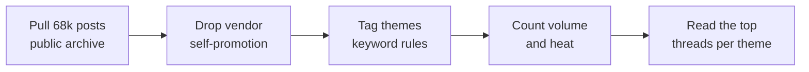

# What the construction trades struggle with

**Independent research** · Oct 2026 · 68,341 public Reddit posts

📄 **Full research paper:** [What the Construction Trades Struggle With: An Analysis of 68,341 Public Reddit Posts](construction-trades-on-reddit-paper.md) (about 4,100 words)

## Question

What are people in the construction subreddits struggling with most, and which struggles draw the most discussion?

## Data and method

- **Source:** 9 subreddits, Apr 11 – Oct 11, 2026, pulled from the Arctic Shift public Reddit archive. Reddit itself blocks automated access, so I found an archive that didn't.
- **Two audiences counted separately:**
  - **Trade pros:** r/Construction, r/electricians, r/Carpentry, r/Contractor, r/ConstructionManagers, r/GeneralContractor. 28,786 posts.
  - **Homeowner-heavy:** r/Plumbing, r/Roofing, r/HVAC. 39,555 posts.
- **Tagging:** a keyword tagger assigned posts to themes. 871 vendor self-promotion posts ("I built an app", "beta") were dropped first.
- **Two measures:**
  - **Volume:** how many posts touch a theme.
  - **Heat:** the median comment count on those posts, against a baseline of 4 for an average post.

## Findings

**Tradespeople who work for someone else**

| # | Struggle | Posts | Heat |
|---|---|---|---|
| 1 | Bad bosses and management | 1,840 | 10 (2.5× baseline) |
| 2 | Breaking in and getting ahead (apprenticeships, union or not) | 1,939 | 9 |
| 3 | Body wearing out, and safety | 1,423 | 6 |
| 4 | Pay | 786 | 11 |
| 5 | Burnout and hours | 403 | **13, the highest of any theme** |

Burnout and pay come up less often than the other themes, but they draw the biggest arguments. The most-discussed post in the whole dataset (2,734 comments) was an apprentice whose boss wanted him to work unpaid Fridays to pay off a mistake.

**Owners and contractors**

| # | Struggle | Posts | Heat |
|---|---|---|---|
| 1 | Customers balking at price | 977 + 138 on price shock | 6 / **12** |
| 2 | Scope creep and difficult clients | 283 | 6 |
| 3 | Getting paid | 187 | 5, but long threads |
| 4 | Licensing, insurance, unlicensed competition | 1,349 | 5 |
| 5 | Finding customers and marketing | 1,200 | 4 (baseline) |
| 6 | Finding and keeping good help | 372 | 5 |

Software and paperwork matched 1,095 posts but had the lowest heat (median 3). Most of it was people pitching tools, so it isn't a real pain signal. **High volume doesn't mean high pain.** That's why heat is measured separately.

## Limits

- Post titles and bodies only. Comments were not read.
- Keyword tagging is rough: one post can land in several themes, and some hits are off-topic ("leads" matching "lead electrician"). The counts show rough volume; the top threads under each theme are the evidence.
- Posts from the last few days of the window have fewer comments than they will eventually get.
